# OpenHamClock User Manual

Everything OpenHamClock can do, and how to use it. New here? Do the five-minute setup in the [Quick Start](QUICKSTART.md) first, then come back when you want the details.

Features tagged are already merged and will ship in the next monthly drop — you'll see them on the staging site and in fresh git checkouts before they reach the hosted site. this manual is also built into the app: **Settings → Help** renders it with a searchable contents sidebar, and the small ❓ icons on panels, map layers, and settings tabs jump straight to the relevant section.

## Contents

- [The basics](#the-basics)
- [The map](#the-map)
  - [Projections: flat, azimuthal, 3D globe](#projections-flat-azimuthal-3d-globe)
  - [Map controls on a phone](#map-controls-on-a-phone)
  - [Basemap styles](#basemap-styles)
  - [Map layers](#map-layers)
  - [DE and DX: markers, click-to-set, favorites](#de-and-dx-markers-click-to-set-favorites)
  - [Cursor readout and nearest city](#cursor-readout-and-nearest-city)
  - [Map Data text view (accessibility)](#map-data-text-view-accessibility)
- [Keyboard shortcuts](#keyboard-shortcuts)
- [Panels](#panels)
  - [Spots and activity](#spots-and-activity)
  - [Propagation and space weather](#propagation-and-space-weather)
  - [Weather, marine and hazards](#weather-marine-and-hazards)
  - [Station and rig](#station-and-rig)
  - [Logging](#logging)
  - [EmComm and mesh](#emcomm-and-mesh)
  - [Utility](#utility)
- [DX cluster in depth](#dx-cluster-in-depth)
- [The logbook](#the-logbook)
- [Propagation in depth](#propagation-in-depth)
- [Satellites](#satellites)
- [Rig control and Rig Bridge](#rig-control-and-rig-bridge)
- [WSJT-X and digital modes](#wsjt-x-and-digital-modes)
  - [Decoder panel: CW from your receiver](#decoder-panel-cw-from-your-receiver)
- [The EmComm layout](#the-emcomm-layout)
- [The EME layout](#the-eme-layout)
- [Alerts and notifications](#alerts-and-notifications)
  - [Lightning guard](#lightning-guard)
- [Home automation (MQTT and Home Assistant)](#home-automation-mqtt-and-home-assistant)
- [Offline mode (PWA)](#offline-mode-pwa)
  - [Offline map areas](#offline-map-areas)
- [Layouts, themes, and profiles](#layouts-themes-and-profiles)
- [Languages](#languages)
- [Remote control and kiosk](#remote-control-and-kiosk)
  - [Remote control API and phone remote](#remote-control-api-and-phone-remote)
  - [Kiosk lock](#kiosk-lock)
  - [Demo mode](#demo-mode)
  - [Grayscale display](#grayscale-display)
  - [Rotating titles](#rotating-titles)
- [Settings reference](#settings-reference)
- [Hosted site vs self-hosted](#hosted-site-vs-self-hosted)

---

## The basics

OpenHamClock is a browser app. Everything you configure — callsign, layout, filters, theme — is saved in that browser's local storage. That has two practical consequences:

- **Nothing follows you between browsers or devices automatically.** Use **Settings → Profiles → Export** to move a configuration, or enable `SETTINGS_SYNC=true` on a self-hosted single-operator install to keep every device in sync from the server.
- **Clearing site data clears your setup** (and your logbook — see [The logbook](#the-logbook)). Export before you spring-clean your browser.

The header bar shows your callsign (click it to open Settings), the version number (click it to open the What's New release notes), UTC and local clocks (click the local clock to flip 12/24-hour), current weather, and live SFI / K / SSN indices. On self-hosted installs an **UPDATE** button appears when a new version is available.

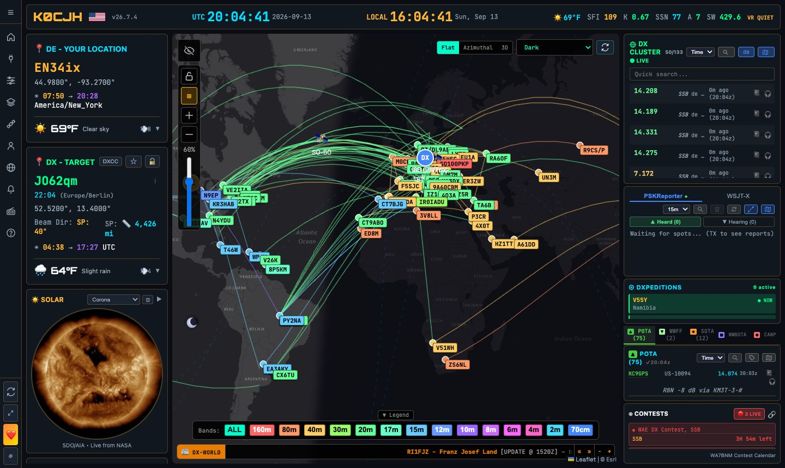

_The Modern layout: header bar with clocks and solar indices, DE and DX panels, the world map, and the spot panels_

Two terms you'll see everywhere, inherited from the original HamClock:

- **DE** — your station ("from" in Morse shorthand).
- **DX** — the target station or location you're interested in working.

---

## The map

The interactive world map is the centerpiece. DX spots, activators, satellites, signal paths, weather, and your own station all live here.

### Projections: flat, azimuthal, 3D globe

A projection toggle on the map switches between three views:

| Projection    | What you get                                                                                                                                                                                                                                                                                                                             |
| ------------- | ---------------------------------------------------------------------------------------------------------------------------------------------------------------------------------------------------------------------------------------------------------------------------------------------------------------------------------------- |
| **Flat**      | Classic Mercator map (Leaflet). Best all-rounder; markers replicate across world copies so nothing vanishes at the antimeridian.                                                                                                                                                                                                         |
| **Azimuthal** | Azimuthal-equidistant projection centered on your QTH — the "beam heading" view. A straight line from center is your true antenna bearing.                                                                                                                                                                                               |
| **3D Globe**  | A WebGL globe with true great-circle arcs, a real day/night terminator, and satellites orbiting at actual altitude with ground tracks and footprints. The 3D engine lazy-loads on first use and renders only when something changes, so an idle globe is cheap even on a Pi. No WebGL? The app falls back to the flat map automatically. |

<table>
<tr><td width="33%" valign="top">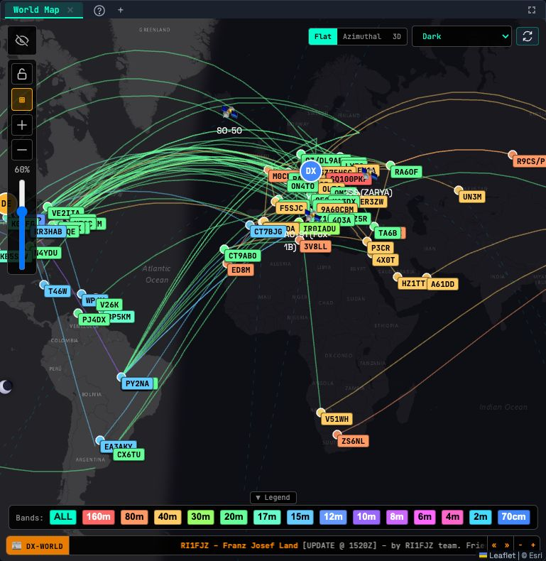 Flat (Mercator)</td><td width="33%" valign="top">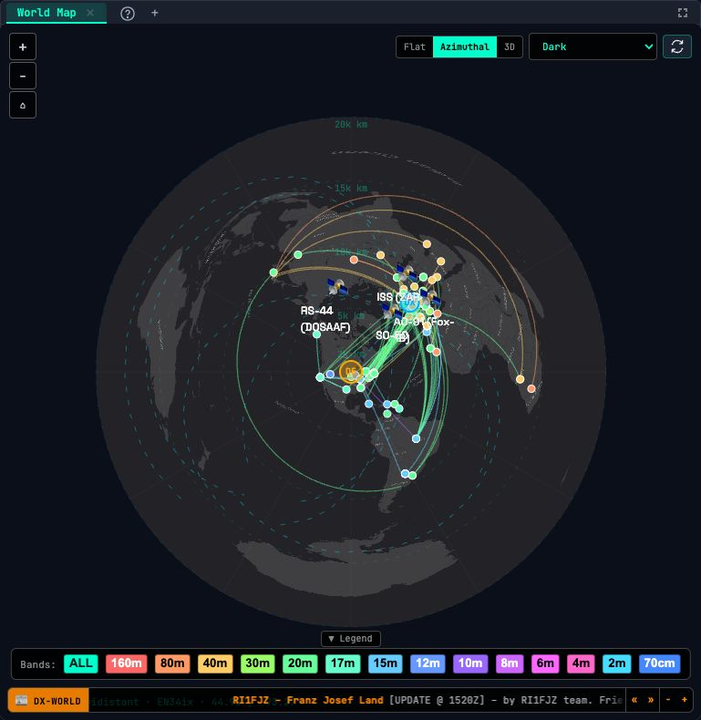 Azimuthal — centred on your QTH</td><td width="33%" valign="top">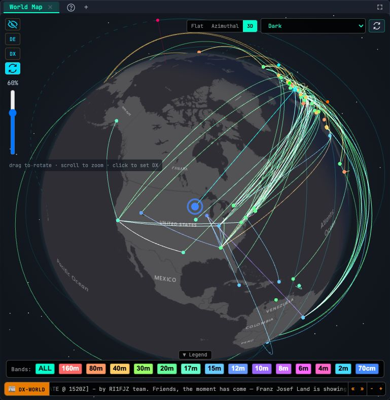 3D globe with satellites at true altitude</td></tr>
</table>

All spot traffic (DX cluster, POTA/SOTA/WWFF/WWBOTA, PSKReporter, WSJT-X) and map overlays render in all three projections. On the globe, zooming in on a satellite swaps its dot for a 3D model — the ISS uses NASA's actual station model; other birds get procedural models matched to their type. The globe's overlay coverage now includes the weather and hazard layers: NEXRAD radar, live lightning, earthquakes, wildfires, floods/severe storms, tornado warnings, live aircraft, and ATC sectors all paint onto the 3D globe (joining aurora, D-RAP, zones, Maidenhead, and worked grids). The **moon** also appears in the 3D scene — at its real position over the Earth, showing its actual current phase via NASA's Dial-A-Moon imagery, refreshed hourly. Size and distance are compressed so it's visible (a to-scale moon would be a sub-pixel dot thirty Earth-widths away); the Earth occludes it correctly as it sets. Both are skipped in Low Memory Mode.

### Map controls on a phone

On a screen narrower than 600 px, on any map narrower than 480 px (a small map panel in the Dockable layout), on a map too short for the full control column (a 7-inch 800×480 kiosk, a phone held sideways) — and always in the Mobile layout — the map's controls fold into a touch-sized set so they don't cover the map: the projection buttons and basemap list move behind one **map menu** button (top right), the night-shading slider becomes a **moon** button that opens a slider beside it, the band legend collapses to a **Bands** chip at the bottom (it shows how many bands you're filtering; tap it to open the band buttons), and the DX news ticker is hidden. The lock and zoom buttons get bigger, and on a map too short even for that column, zoom, the call-labels toggle and night shading tuck behind a **⋯** button that opens them as a row beside it, so the column never runs into the layout's own buttons at the bottom of the map (Classic's Settings and DX-lock row, for example). An open menu, slider or band list closes when you tap or drag the map, or press Esc — and that tap only closes it: it doesn't also set DX, open a spot or start a pan. Resize a Dockable map panel past 480 px and the controls switch over as you drag. Larger maps keep the full controls.

### Basemap styles

Pick the base tiles from the style dropdown on the map: **Dark** (default), **Satellite** (with real polar imagery on the globe), **Modis Truecolor** (NASA GIBS), **Terrain**, **Streets**, **Topo**, **Ocean**, **Hybrid**, **Gray**, **Nat Geo**, and **Countries**, plus five national topographic maps that [offline map areas](#offline-map-areas) can be saved from: **USGS Topo** (United States), **Plan IGN** (France), **GSI Standard** (Japan), **Kartverket Topo** (Norway), and **GA Base Map** (Australia). Each is detailed only in its own country, so they stay out of the default map-style rotation. If you add your own tile server (see [offline map areas](#offline-map-areas)), it appears in the list too.

Two notes:

- **CARTO key (optional).** Dark and Streets default to Esri tiles that need no key. If you liked the original CARTO look (with localized labels), grab a free key at carto.com/basemaps/apikey (5M tiles/month) and paste it in **Settings → Integrations → CARTO Basemap Key**. The key is stored only in your browser and never synced or shared.
- **Map style rotation.** For wall displays, the basemap can cycle automatically through styles you pick, on an interval you set (default 60 s). This works in every projection, including the 3D globe, where each switch rebuilds the globe texture; Modis Truecolor is 2D-only and is skipped while the globe is up.

Other map controls: zoom, a **map lock** (prevents accidental pan/zoom on touch screens), a **night darkness** slider that sets how dark the night side is shaded, and a **hide UI** eye toggle that clears all on-map controls for a clean wall display — on the flat map and the 3D globe alike, leaving just the eye button to bring them back.

### Map layers

Around 29 overlay layers can be toggled from **Settings → Map Layers** (grouped by category, each with an opacity slider) or with the single-key [keyboard shortcuts](#keyboard-shortcuts). All layers except Satellite Tracks default to off.

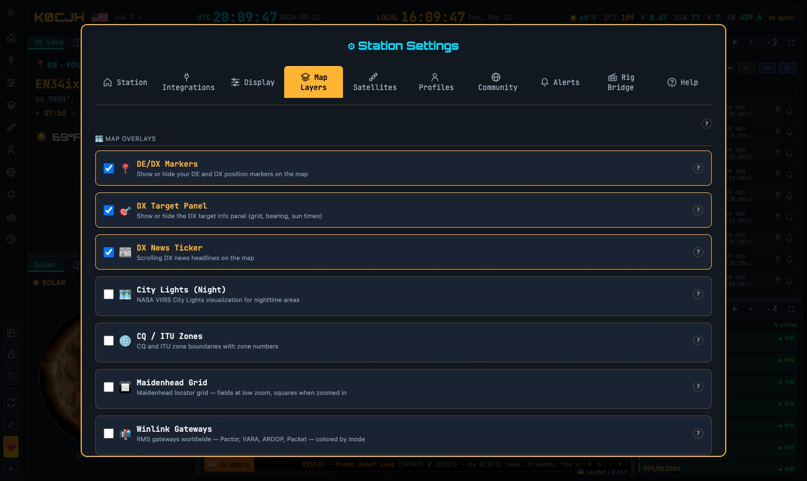

_Settings → Map Layers: every overlay grouped by category, each with an opacity slider_

**Propagation**

| Layer                  | What it shows                                                                  | Key |
| ---------------------- | ------------------------------------------------------------------------------ | --- |
| Gray Line              | Day/night terminator with twilight zones and an enhanced-DX zone               | G   |
| VOACAP Propagation Map | Color-coded HF propagation predictions from your station to the world          | V   |
| MUF Map                | Estimated Maximum Usable Frequency from your station, from live ionosonde data | M   |
| DE/DX Great Circle     | Short-path and long-path great circle between DE and DX                        | D   |
| Reverse Beacon Network | Live RBN spots — "who hears me?" or flip it to "what does this skimmer hear?"  | R   |
| WSPR                   | WSPR propagation paths and signal reports (opt-in)                             | P   |
| IBP Beacons            | NCDXF/IARU International Beacon Project — live deterministic schedule          | —   |
| PSKR Band Activity     | Spot counts per HF band from PSKReporter                                       | B   |

**Amateur radio**

| Layer               | What it shows                                                                                                                                                                                       | Key |
| ------------------- | --------------------------------------------------------------------------------------------------------------------------------------------------------------------------------------------------- | --- |
| Contest QSOs        | Recent QSOs from contest loggers (N1MM/DXLog) as band-colored arcs                                                                                                                                  | Q   |
| Meshtastic Nodes    | Mesh network nodes from your Meshtastic device                                                                                                                                                      | —   |
| Worked Grids        | Shades Maidenhead squares you've worked, straight from your logbook                                                                                                                                 | —   |
| Balloons (HAB/Pico) | Amateur high-altitude and pico balloons from SondeHub Amateur — altitude-coloured markers with 6-hour trails, APRS-gated picos dashed; click → details and Set as DX. Pairs with the Balloons panel | —   |

**Weather / space weather / hazards / geology**

| Layer               | What it shows                                                                                                                                                                                                                                                      | Key |
| ------------------- | ------------------------------------------------------------------------------------------------------------------------------------------------------------------------------------------------------------------------------------------------------------------ | --- |
| Weather Radar       | NEXRAD precipitation radar (North America)                                                                                                                                                                                                                         | W   |
| Global Clouds (OWM) | Real-time cloud cover (self-hosted only; needs an OpenWeatherMap key)                                                                                                                                                                                              | O   |
| Lightning Activity  | Live lightning strikes worldwide, last 30 minutes                                                                                                                                                                                                                  | L   |
| Aurora Forecast     | NOAA OVATION aurora probability (30-minute forecast)                                                                                                                                                                                                               | A   |
| D-RAP Absorption    | NOAA D-region absorption prediction — where HF is being eaten                                                                                                                                                                                                      | J   |
| Tornado Warnings    | Active NWS tornado watches/warnings/emergencies (US)                                                                                                                                                                                                               | T   |
| Wildfires           | Active wildfires worldwide (NASA EONET)                                                                                                                                                                                                                            | F   |
| Floods & Storms     | Active floods and severe storms worldwide (NASA EONET)                                                                                                                                                                                                             | I   |
| Earthquakes         | USGS quakes, M2.5+ in the last 24 hours, with a magnitude filter                                                                                                                                                                                                   | E   |
| Tropical Cyclones   | Active hurricanes/typhoons/tropical storms worldwide (NHC + JTWC): hurricane symbol scaled and coloured by category, forecast track with hour/intensity points, cone of uncertainty (NHC) or 34 kt danger swath (JTWC). Click a storm for details or **Set as DX** | —   |
| Fire Weather Alerts | NWS Red Flag Warnings (solid red) and Fire Weather Watches (dashed amber) drawn as fire-zone polygons (US)                                                                                                                                                         | —   |
| NDBC Buoys          | Every reporting NOAA NDBC buoy / coastal station, coloured by wave height; click for wind, waves, pressure, air/water temperature                                                                                                                                  | —   |

**Overlays and more**

| Layer                | What it shows                                                                                                                                                                                                                                                                                                                                                                                                                                                                              | Key |
| -------------------- | ------------------------------------------------------------------------------------------------------------------------------------------------------------------------------------------------------------------------------------------------------------------------------------------------------------------------------------------------------------------------------------------------------------------------------------------------------------------------------------------ | --- |
| Satellite Tracks     | Real-time satellite positions with tracks and footprints (on by default)                                                                                                                                                                                                                                                                                                                                                                                                                   | S   |
| Maidenhead Grid      | Locator grid — fields at low zoom, squares when zoomed in                                                                                                                                                                                                                                                                                                                                                                                                                                  | H   |
| CQ / ITU Zones       | Zone boundaries with zone numbers                                                                                                                                                                                                                                                                                                                                                                                                                                                          | Y   |
| Political Boundaries | Country borders plus US state and Canadian province lines, drawn over any basemap. Two colour pickers in the layer's settings (national, state/province) and a toggle for the state/province lines                                                                                                                                                                                                                                                                                         | —   |
| City Lights          | NASA VIIRS nighttime city lights                                                                                                                                                                                                                                                                                                                                                                                                                                                           | C   |
| Winlink Gateways     | 4,800+ RMS gateways colored by mode (Pactor, VARA, ARDOP, Packet) with filters. Set the **Reachability** filter to _Predicted reachable_ or _Good only_ and the layer predicts HF reachability itself and colors markers Good / Marginal / Closed / Off the air (grey = not predicted); it does the same whenever the Winlink panel's **Reachable** view or the EmComm gateway list is showing predictions                                                                                 | K   |
| Aircraft             | Live civilian aircraft (adsb.lol), with an optional track-prediction lead time                                                                                                                                                                                                                                                                                                                                                                                                             | X   |
| ATC Sectors          | FIR/ARTCC boundaries with primary frequencies and LiveATC links                                                                                                                                                                                                                                                                                                                                                                                                                            | Z   |
| Active Users         | Other OpenHamClock operators, live (opt out in Settings → Station)                                                                                                                                                                                                                                                                                                                                                                                                                         | U   |
| Logged QSOs (N3FJP)  | Recently logged QSOs and live entry previews from the N3FJP bridge (self-hosted); each contact gets a callsign pill in the layer colour (previews with a trailing ?) that follows the map's Show/Hide Calls button                                                                                                                                                                                                                                                                         | N   |
| Logged QSOs (API)    | QSOs pushed by any external logger via the open REST API (self-hosted) — see [API.md](API.md); callsign pills as above, per-QSO colours carry into the pill                                                                                                                                                                                                                                                                                                                                | —   |
| History Playback     | Scrub through the last 24h of DX spots — timeline slider, 5–60 min window, play/pause with speeds up to 15 min/s, paths colored by band. Works on the flat map and the 3D globe, sharing one timeline. While you are scrubbed into the past the live DX cluster paths are hidden on every projection so only the replayed spots show; LIVE brings them back. History records from server start; the control says how far back it goes and tells you when you have scrubbed past the start. | —   |
| Time Shift           | A floating scrubber that moves the whole dashboard's **display time** up to ±30 days — see [Time shift](#time-shift) below. Works on every projection.                                                                                                                                                                                                                                                                                                                                     | —   |

| Launch Sites | Launch pads with an upcoming orbital launch (Launch Library 2) as rocket markers — tooltip and popup carry the T-0 countdown, a _Set DX here_ button points the DX target at the pad, and a pad inside two hours of launch is drawn larger. Flat map only; the Space Launches panel covers the globe. | — |

**Auto space-weather layer** (Settings → Map Layers, off by default): let the map react to space weather on its own. Every five minutes the server's `/api/swpc/activity` summary is checked — when NOAA's OVATION aurora probability peaks at 50 % or more the **Aurora Forecast** layer switches on, and when the D-RAP absorption reaches 25 MHz the **D-RAP Absorption** layer switches on. They switch off again only when the activity has clearly subsided (below 25 % / 15 MHz), so a value hovering at the threshold never flaps the map. Any of those two layers you toggle yourself (Settings, shortcut key or command palette) while the feature is on is treated as pinned for the rest of the session and left alone; turning the setting off releases the pins and removes the layers it had enabled.

**Write your own layer or panel:** drop a plugin file into `src/plugins/local/` (map layers) or `src/plugins/local/panels/` (dockable panels) and it's auto-discovered — no registration, and it survives updates. See [PLUGINS.md](PLUGINS.md).

### Time shift

Shift the **display time** forward or back and the dashboard shows that moment instead of now — where the terminator and gray line will be at your sked time, the sun and moon, every satellite's position, track and footprint, the next passes, the VOACAP chart's "now" column, and the header clocks. Live spot feeds (cluster, POTA, PSKReporter, APRS…) are **not** shifted — they are always live.

- **The control:** turn on the **Time Shift** layer (Settings → Map Layers, the command palette, or the layer list) and a small draggable, minimisable panel appears on the map with **−1w / −1d / −1h / +1h / +1d / +1w** buttons, a slider spanning ±30 days, the shifted UTC time, and a **Now** button. Drag the title to move it; double-click the title to reset its position; × closes it (the shift stays until you press Now).
- **The badge:** while the offset is anything but zero, the header clocks (and the Clock layout) carry a red **NOT REAL TIME** badge with the offset. Click the badge to snap back to real time.
- **Keys:** `[` and `]` step −/+1 hour, `{` and `}` −/+1 day, `0` returns to now (listed in the `?` shortcuts panel).
- **Planners:** rows in the Grayline, EME and Satellite planner panels are clickable — "Show on map" sets the display time to that window's start so you can see the geometry.
- The shift lives for the session only (a reload is always real time) and never moves the alarm clock, which rings on real time.
- **Remote control:** `window.dispatchEvent(new CustomEvent('ohc:set-time', { detail: { offsetMs: 3600000 } }))`, `{ iso: '2026-12-21T12:00:00Z' }`, or `'now'` drives it from the console or a kiosk/remote-control integration.

### DE and DX: markers, click-to-set, favorites

- **Your station (DE)** is marked at your configured location. The DE panel shows grid, coordinates, sunrise/sunset, and local weather.
- **Click anywhere on the map** to set the DX target there. The DX panel updates with bearing, distance, grid, sun times, and (optionally) weather; the propagation panels recalculate for the new path.
- **Click any spot** (cluster, POTA, PSK, WSJT-X…) to set that station as the DX target. The map drops a short expanding-ring **pulse** on the target so your eye finds it in a busy view, and pans to it if it is off-screen (if it is already in view the map stays put). APRS panel rows and, in the EmComm layout, station, gateway, and roster rows work the same way. On the Azimuthal view the ring is drawn without panning; on the 3D globe the camera swings to the station and the ring pulses on the surface.
- **Type a locator:** click the DX grid display and enter a grid like `JN58sm`.
- **DX Favorites:** star up to 10 DX grids for one-click recall — great for regular skeds.
- **DXCC entity picker:** browse/search the full DXCC list next to the DX grid display.
- If you have a rotator connected, **Shift+click the map** to turn the antenna to that bearing.

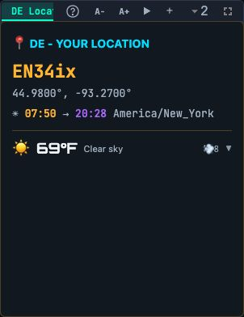

_The DE and DX panels: grid, coordinates, sun times, weather, and the DX bearing and distance_

### Cursor readout and nearest city

Move the mouse over the map and a small strip in the top-right corner of the map shows the cursor's latitude/longitude, Maidenhead square, distance and bearing from DE, and — when one is within about 100 km — the nearest city with its population ("Boston (650k) 12 km"). The city list is bundled (around 2,000 cities over 300,000 people, from GeoNames), so it works offline. The azimuthal projection shows the same information in its cursor tooltip. The readout hides with the rest of the map UI.

### Map Data text view (accessibility)

The **Map Data (text view)** panel renders the map's content as structured, screen-reader-friendly text: DX spots, satellites currently above your horizon, ground activations, lightning, aurora, aircraft, and Winlink gateways. Tab strips throughout the app follow the ARIA tablist pattern (arrow-key navigation), and live announcements fire for new DX spots and, with the [lightning guard](#lightning-guard) on, for lightning warnings and alarms. Add the panel from the dockable layout's panel picker.

---

## Keyboard shortcuts

Press **`?`** anywhere to open the shortcuts panel. Shortcuts are ignored while typing in a text field, while a modal is open, or when Ctrl/Alt/Cmd is held. Layer keys are pinned — adding new layers never reshuffles them.

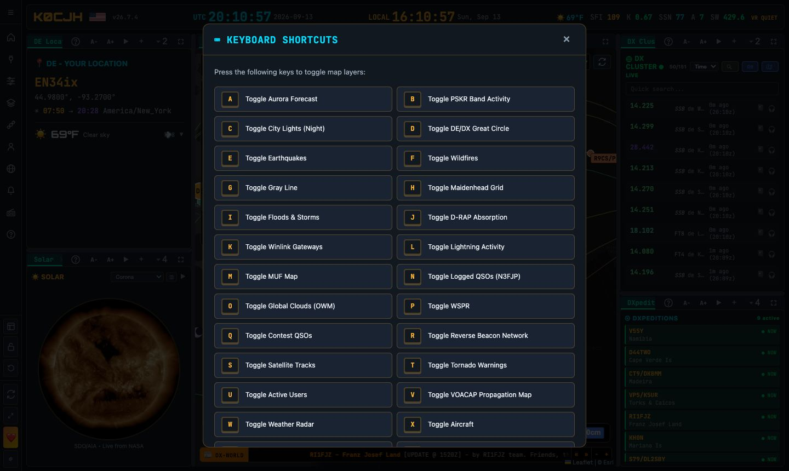

_The shortcuts panel (press ? anywhere)_

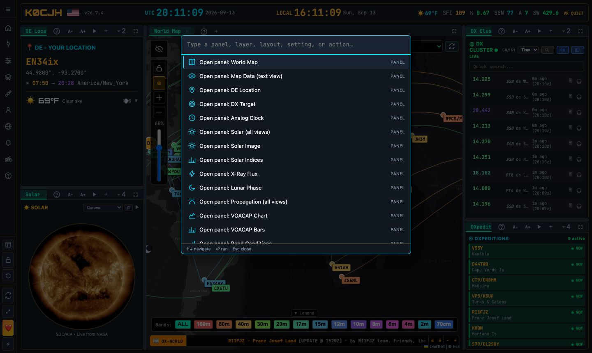

_The command palette (Ctrl/Cmd+K): jump to any panel, layout, layer, or setting by name_

**Command palette.** Press **Ctrl+K** (⌘K on Mac) for a fuzzy-searchable list of most things you can do: toggle map layers, switch layouts (named dockable presets included, as "Dockable — _name_"), open Settings on a specific tab, jump to a manual topic, toggle fullscreen, open What's New — and, in the Dockable layout, open or focus any panel. Arrow keys select, Enter runs, Esc closes.

| Key     | Action                                              |
| ------- | --------------------------------------------------- |
| `?`     | Toggle the keyboard shortcuts help panel            |
| `/`     | Toggle DE and DX markers                            |
| `[` `]` | Display time −/+ 1 hour ([Time shift](#time-shift)) |
| `{` `}` | Display time −/+ 1 day                              |
| `0`     | Display time back to now                            |
| Esc     | Close the open modal                                |
| A       | Aurora Forecast                                     |
| B       | PSKR Band Activity                                  |
| C       | City Lights (Night)                                 |
| D       | DE/DX Great Circle                                  |
| E       | Earthquakes                                         |
| F       | Wildfires                                           |
| G       | Gray Line                                           |
| H       | Maidenhead Grid                                     |
| I       | Floods & Storms                                     |
| J       | D-RAP Absorption                                    |
| K       | Winlink Gateways                                    |
| L       | Lightning Activity                                  |
| M       | MUF Map                                             |
| N       | Logged QSOs (N3FJP)                                 |
| O       | Global Clouds (OWM)                                 |
| P       | WSPR                                                |
| Q       | Contest QSOs                                        |
| R       | Reverse Beacon Network                              |
| S       | Satellite Tracks                                    |
| T       | Tornado Warnings                                    |
| U       | Active Users                                        |
| V       | VOACAP Propagation Map                              |
| W       | Weather Radar                                       |
| X       | Aircraft                                            |
| Y       | CQ / ITU Zones                                      |
| Z       | ATC Sectors                                         |

The alphabet is fully spoken for, so a few newer layers (Meshtastic Nodes, IBP Beacons, Worked Grids) have no key — toggle those from Settings → Map Layers.

Mouse extras: **Shift+click** the map turns a connected rotator; holding **Ctrl** in Settings → Map Layers reveals per-layer "reset popups" buttons if a draggable legend ever gets lost off-screen.

---

## Panels

In the **Dockable** layout, every panel below can be added from the **+** panel picker — a category-grouped, multi-column grid that scrolls — then dragged, tabbed, split, and resized however you like (a lock toggle freezes the arrangement). Other layouts include a curated subset.

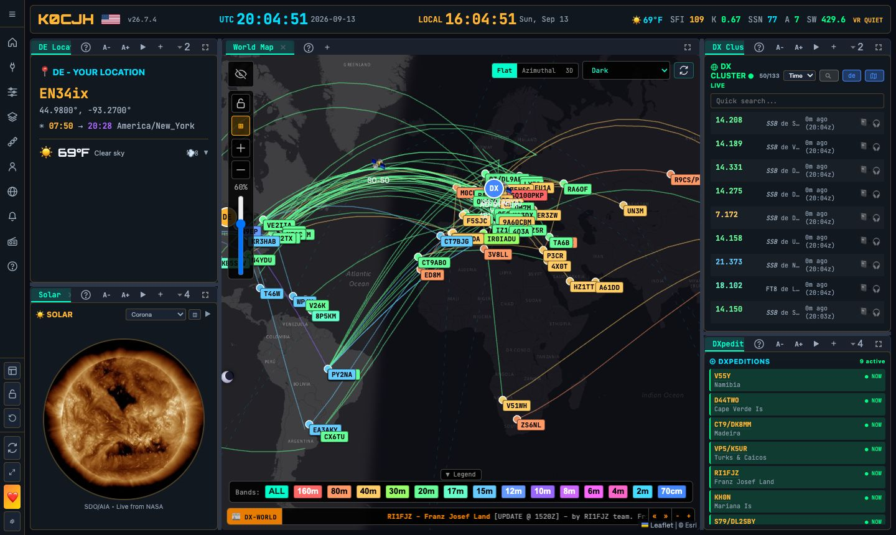

_The Dockable layout: panels as draggable, tabbable, resizable tiles_

### Spots and activity

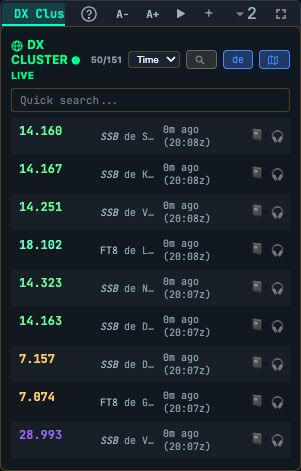

_The DX Cluster panel: band-coloured spots with age, mode, and the tune / listen / log buttons_

- **DX Cluster** — live spots with band coloring, filtering, worked/dupe badges, click-to-tune, click-to-listen, and log-from-spot. Detailed below in [DX cluster in depth](#dx-cluster-in-depth).
- **PSK Reporter** — who hears you (**TX** tab) and who you hear (**RX** tab) on digital modes, live via a server-side MQTT proxy with HTTP fallback. Filter by band, mode, retention window (2–15 min), callsign or grid. A gold star ★ marks _mutual_ reception — you hear them and they hear you on the same band, so a QSO is likely. A trash-can button clears all spots.
- **POTA / SOTA / WWFF / WWBOTA** — currently active Parks, Summits, Flora & Fauna, and Bunkers on the Air activators, each with its own marker shape and color on the map (▲ green, ◆ orange, ▼ light green, ■ light purple). QRT and expired spots are filtered automatically. Band/mode/grid filters per panel; SOTA spots include summit name, altitude, and points.
- **DXpeditions** — active and upcoming DXpeditions (NG3K data) with real operating callsigns, dates, and modes.
- **Contests** — the WA7BNM contest calendar with countdowns and links; active contests highlighted. Contests inside NOAA's 27-day window carry a **weekend outlook pill** — _Quiet / Unsettled / Active / Storm_ from the largest predicted Kp across the contest's days, plus the predicted SFI — with the full numbers in the tooltip (see the 27-Day Solar Outlook panel below).
- **Opportunities** — a ranked list of what is worth working _right now_. Every station spotted in the last 15 minutes (DX cluster plus POTA/SOTA/WWFF/WWBOTA) is scored as **need × activity × reliability**: need comes from your native logbook (badges **NEW DXCC**, **NEW BAND** slot, **NEW ZONE** for WAZ, **NEW GRID** for VUCC, **NEW STATE** for WAS — the last two only once your log carries grids/states), activity is the number of distinct spotters decayed by spot age, and reliability is the ITU-R P.533 circuit reliability from your QTH to the spot for this hour, computed in your browser for the top 40 candidates and cached ten minutes (shown as a percentage; when no prediction is available yet the row falls back to the server's band-opening detector, shown as "~nn%"). Click a row to tune the rig and set DX (same handler as the DX Cluster panel), 📓+ logs it. Without a logbook the list still ranks by activity and path. An optional **Opportunities** alert feed (Settings → Alerts) fires when a new _top-five_ entry is at least a new DXCC entity.
- **DX News ticker** — headlines merged from DXNews.com, DX-World, and NG3K, deduplicated over 24 hours, with adjustable text size and scroll speed (« » buttons, 0.5×–2.5×).
- **DX News** — the same merged three-source feed as the ticker, but as a full reader panel: newest-first list with source badges and relative ages, expandable summaries with a link to the original article, per-source filter chips, and a read/unread dot that remembers what you've already seen (stored locally, capped at 200 items).
- **POTA Activator** — self-spotting for park activations. Enter the park reference (verified live against the POTA park directory, so you see the park name before you post), frequency in kHz, and mode; the spot posts to pota.app under your callsign. POTA's response is shown verbatim, and a 30-second cooldown prevents accidental double-spots. Re-spot after a QSY to stay on the hunters' active list.
- **HamAlert** — your own [HamAlert](https://hamalert.org) triggers as a live list: age, callsign, frequency, mode, source (RBN, PSKReporter, SOTA, POTA, cluster…) and comment, newest first, up to 200; **CLR** empties it. Click a row to set the DX target and tune the rig, exactly like a DX Cluster spot. The feed needs your HamAlert login, so it is per-user: enable the **HamAlert** plugin in Rig Bridge (Plugins tab → username/password) and alerts stream to the browser over the bridge's local connection or Cloud Relay. A self-hosted server can instead hold one shared session with `HAMALERT_USER` / `HAMALERT_PASS` in `.env`. Settings → Alerts has a matching **HamAlert** tone/notification feed. Tip: in HamAlert, add a _Telnet_ destination to the triggers you want here.

### Propagation and space weather

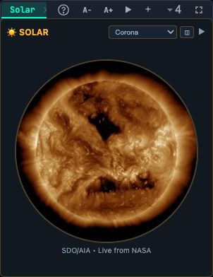

_The Solar panel cycling through live imagery, indices, X-ray flux, and the moon_

- **Propagation (VOACAP Chart / Bars)** — per-band reliability between DE and DX, as a 24-hour chart or as bars for right now. Detailed below in [Propagation in depth](#propagation-in-depth).
- **Sked Planner** — best times to work the current DX target over the next 48 hours: a band × hour grid colored by the same P.533 predictions the VOACAP panel computes (same mode/power/antenna settings — changing them here changes them everywhere), annotated with UTC plus both stations' local hours and sunrise/sunset markers, with the top three contact windows called out ("Best: 20m 02:00–05:00z"). Day 2 tiles the 24-hour monthly-median prediction honestly — HF predictions repeat diurnally, so it's labeled as a repeat, not a fresh forecast.
- **Ionosondes** — live foF2 and MUF(3000) measured by real GIRO digisondes (via prop.kc2g.com), sorted by distance from your QTH. The nearest station gets a "your local ionosphere" summary: foF2 translated into an NVIS usability hint and MUF(3000) into the highest band worth trying for DX. Measurements, not models — the ground truth the VOACAP predictions try to approximate.
- **Prediction Check** — is the band open to where you are pointing? For each HF band, three pieces of evidence for the **DE → DX path** (the header names both ends, the distance and the bearing): the ITU-R P.533 circuit reliability for this UTC hour with your mode, power and antenna (cyan, recomputed whenever you change DX); DX cluster and PSKReporter spots from the last 15 minutes whose two ends sit on your continent and the DX continent (green — activity, not reliability); and, with a KiwiSDR beacon monitor running, the best measured SNR of NCDXF beacons within 4,000 km of DX (amber). Each row carries a one-line explanation and a plain-language status: **OPEN · confirmed** (model ≥ 50 % and activity seen), **OPEN · no spots yet**, **MARGINAL** (15–50 %), **CLOSED**, or **OPEN · model said closed** (three or more spots on a path the model rates under 15 % — trust the air). "What am I looking at?" at the bottom explains the bars and the rules.
- **Band Conditions** — N0NBH's band-by-band day/night condition ratings, VHF aurora/E-skip status, and geomagnetic summary.
- **Band Health** — a "what's actually happening" view computed from live DX cluster spot activity per band, with a mode breakdown. Not a model — observed reality.
- **Band Activity (Continent)** — a DX-Heat-style continent × band heatmap of cluster spots over the last 15/30/60 minutes.
- **Band Activity (PSKR)** — spot counts per HF band from PSKReporter.
- **IBP Beacons** — which NCDXF/IARU beacon is transmitting on each of the five beacon bands _right now_ (the schedule is deterministic — no network needed), with countdowns and bearings, plus a listening-log timeline showing which beacons RBN skimmers heard in each 3-minute cycle. A third **MEASURED** view shows the SNR of every beacon on every band as measured by your own KiwiSDR beacon monitor (Rig Bridge plugin) — see [Measured beacon SNR](#measured-beacon-snr-kiwisdr-beacon-monitor).
- **Solar (all views, or individual panels)** — cycles through: live solar imagery (SDO with LMSAL and Helioviewer fallbacks), solar indices with 30-day history, GOES X-ray flux (6/12/24/48-hour windows with flare classification), and lunar phase with real NASA Dial-A-Moon imagery plus EME moon pointing data (azimuth/elevation, rise/set, distance).
- **Solar Cycle** — the big picture: monthly observed sunspot numbers (thin line) and the official smoothed SSN (bold line) since 2015, overlaid on NOAA SWPC's cycle-25 predicted range band, with a "you are here" marker on the latest observation and current SSN/SFI readouts. One glance answers "are we past the peak?".
- **Space Wx Alerts** — recent NOAA SWPC alerts, watches, and warnings with R/S/G severity chips.
- **Space Wx Trends** — where conditions are _heading_: 24-hour sparklines of solar wind speed, IMF Bz, and GOES ≥10 MeV proton flux from NOAA's real-time feeds. Southward (negative) Bz turns amber then red — sustained south Bz plus rising wind speed is the classic prelude to a geomagnetic storm, hours before the K-index shows it.
- **Meteor Showers** — annual showers for meteor-scatter operators, sorted by proximity to peak, with ZHR and live radiant elevation from your QTH.
- **NOAA Scales** — the three NOAA space weather scales exactly as swpc.noaa.gov presents them: today's observed **R** (radio blackout), **S** (solar radiation storm) and **G** (geomagnetic storm) level, colour-coded 0–5 with a one-line HF impact, then the 1/2/3-day forecast — G as a predicted level, R and S as the probability of reaching R1/R3 and S1. The current R/S/G levels also appear as three small chips in the Space Wx Alerts panel header.
- **Dst Index** — the Kyoto WDC real-time Dst index, the ring-current measure of a geomagnetic storm: current value in nT, a 24 h / 72 h hourly sparkline with the ±10 nT comfort band shaded, the storm minimum, a 3-hour trend, and a plain-language reading. Near zero is quiet; beyond about ±10 nT the 160 m path starts to suffer; −50 / −100 / −250 nT mark minor, moderate and intense storms; a positive spike is a sudden commencement (a CME has arrived — the storm follows). Source is Kyoto's live table, with NOAA's mirror as fallback. The latest Dst and the GOES ≥2 MeV **electron flux** are also shown as rows in the Solar Indices view, and the electron flux gets its own 24 h sparkline in Space Wx Trends (satellite operators: >1000 is NOAA's spacecraft-charging alert level).
- **Eclipses** — the next solar and lunar eclipses (then the following few): type, date and time of greatest eclipse (UTC), where on Earth it is visible, gamma and magnitude, with a small Sun/Moon glyph drawn for the type. For your DE location it says whether you can see it — for solar eclipses the local maximum time, obscuration percentage (or TOTAL / ANNULAR) and sun elevation, for lunar ones whether the Moon is up during the umbral phase. The canon is computed (Meeus) and merged with a bundled NASA GSFC visibility table for 2026–2040; the DE obscuration is an estimate (±5 %), so a deep total may read 98 % — plan with eclipse.gsfc.nasa.gov.
- **Planets** — azimuth, elevation, next rise and set (local time), and distance for the Sun, Moon, Mercury, Venus, Mars, Jupiter, Saturn, Uranus and Neptune from DE, refreshed every minute; bodies above the horizon are highlighted and the tooltip gives RA/Dec and the elongation from the Sun (evening or morning object). Computed locally from Keplerian elements to about an arcminute — no network needed.
- **Sun & Moon** — sunrise/sunset (UTC) and current twilight state, moonrise/moonset (local), and live moon azimuth/elevation for both DE and the DX target, plus the current phase. Greyline chasers get both ends of the path at a glance; EME operators get pointing without opening the lunar panel.
- **Grayline Planner** — when are DE and the DX target _both_ on the gray line? A seven-day timeline (one row per UTC day) paints each station's twilight windows — sunrise and sunset ± a margin you choose (15–90 minutes, default 30) — and highlights the overlaps in green, with a countdown to the next mutual window and a table of upcoming windows in UTC and your local time, tagged sunrise/sunset at each end. Click a window to set the [display time](#time-shift) to its start and watch the terminator line up. Pure local math (the same NOAA sunrise/sunset the DE/DX panels use) — no network.
- **My Signal (RBN)** — who is hearing _you_: live Reverse Beacon Network skimmer reports of your callsign from the last 30 minutes, grouped by band with SNR and CW speed. Call CQ on CW/RTTY/FT modes and watch your signal land — the honest antenna-comparison tool.
- **WSPR My Spots** — where your WSPR beacons were received in the last 24 hours (via the [wspr.live](https://wspr.live) archive): per-band counts, unique receivers, best DX, and the full reception list with SNR and distance. The milliwatt companion to the RBN panel.
- **Station Benchmark** — how your station is heard _compared with your neighbours_. The server keeps a week of RBN skimmer reports for every spotted station and, for your callsign, matches each (skimmer, band, UTC hour) bucket against the median of the stations within 100/300/600/1000 km of your QTH heard by the _same_ skimmer in the _same_ hour — so propagation cancels out and what remains is antenna, power and QTH. Per-band bars of "you − neighbours" dB with the number of matched skimmer-hours, a 7-day trend sparkline per band, and a plain-language explanation line. RBN only (CW/RTTY/FT-mode skimmers): PSK Reporter "my spots" carry no SNR in OpenHamClock, so FT8 reports are not compared. Needs a callsign and location; neighbours only count once their location is known precisely (callbook or cluster grid), which the server resolves slowly in the background around places that have been asked about.
- **27-Day Solar Outlook** — NOAA SWPC's 27-day outlook of predicted 10.7 cm flux, planetary A index and largest Kp per UTC day: sparklines plus a table with a _Quiet / Unsettled / Active / Storm_ pill per day, weekends tinted and today highlighted. Reissued daily by SWPC and cached six hours on the server. The same data feeds the per-contest pills in the Contests panel.

### Weather, marine and hazards

- **Tropical Cyclones** — every active hurricane, typhoon and tropical storm worldwide, strongest first: category badge, name and basin, maximum wind, position, movement, and distance/bearing from DE. Expand a storm for pressure, gusts, the advisory number and age, the official forecast table (hour, valid time, position, wind) and links to the NHC advisory/discussion/graphics or JTWC warning. Clicking a storm sets the DX target on its centre and pans the map there. Atlantic and East/Central Pacific storms come from NHC (with the forecast track and cone of uncertainty from its KMZ products); the West Pacific, Indian Ocean and southern hemisphere come from JTWC's warnings. Pair it with the **Tropical Cyclones** map layer.
- **Fire Weather** — NWS Red Flag Warnings and Fire Weather Watches (US), nearest to DE first, with distance and bearing, the affected fire-weather zones, start/end times and the issuing office; expand for the full text. A distance filter (250/500/1000 km or all) keeps the list local. Clicking an alert sets DX on the alert area's centre. Zone outlines are resolved by the server a few seconds after a new alert appears, so a brand-new alert may briefly say "map outline loading". The **Fire Weather Alerts** map layer draws the same polygons; the existing **Wildfires** layer shows the fires themselves.
- **Marine Wx (Buoys)** — the nearest NOAA NDBC buoys and coastal stations to DE: wind direction/speed/gusts in knots, significant wave height with dominant period and direction, barometric pressure and 3-hour tendency, air and water temperature, and the observation age. Choose 10/25/50 stations; **Buoys only** hides water-level and other coastal stations without marine data. Clicking a row sets DX on the buoy. The **NDBC Buoys** map layer plots every station.
- **Windy** — an embedded [Windy.com](https://www.windy.com) map centred on DE (or on the DX target with the DX button) with a selector for wind, rain, clouds, temperature, pressure or wave overlays and ± zoom. The embed loads only when the panel is actually on screen, so a hidden tab costs nothing; your overlay, zoom and centre choice are remembered.
- **WEFAX Charts** — browse the NWS/USCG HF radiofax charts broadcast by Boston (NMF), New Orleans (NMG), Point Reyes (NMC), Honolulu (KVM70) and Kodiak (NOJ): surface analyses and forecasts, wind/wave and sea-state charts, 500 mb charts, tropical cyclone danger areas, SST and ice charts. Pick a station and a chart; the latest issuance is fetched from NOAA through the server (cached 30 minutes) and shown fit-to-panel or zoomable with drag-to-pan. The station's broadcast frequencies are listed as USB dial frequencies (assigned carrier − 1.9 kHz); with rig control enabled, clicking one tunes the radio to USB so a decoder such as fldigi can copy the fax.

### Station and rig

- **DE Location / DX Target** — station info panels: grid, coordinates, sun times, weather (collapsible), and for DX: bearing and distance (handy for aiming a beam). **Settings → Station → Bearings** switches every bearing in the app between **True north** (default) and **Magnetic north**: magnetic bearings are corrected by the World Magnetic Model (WMM2025, computed in the browser from your station location — no network) and carry an **M** suffix ("116°M"), so what you read here matches a compass or a rotator calibrated to magnetic. Applies to the DX panel SP/LP readouts, the Classic layout, callsign lookup, the Map Data text view, the azimuthal map tooltip, the Rotator readout, and the IBP, Repeaters, Aircraft Nearby and Balloons lists.
- **Analog Clock** — a classic clock face with date, sunrise, and sunset. Also available in the Classic layout via `CLASSIC_ANALOG_CLOCK=true`.
- **Ambient Weather** — your own AmbientWeather.net station's live data (appears only when `VITE_AMBIENT_*` keys are configured).
- **Rig Control** — current frequency and mode from your radio via Rig Bridge, with a band plan overlay on the frequency display and PTT status. Set your US license class in Settings → Station and the band plan bar hatches out the ranges outside your privileges (Technician/General/Amateur Extra, per the FCC Part 97 / ARRL band chart); leave it on Other for no restriction display.
- **Frequencies** — your own named channel list: calling frequencies, repeaters, club nets, whatever you keep going back to. Each entry has a name, frequency, optional mode and notes, and a band chip; with rig control enabled, clicking a row tunes the radio (same click-to-tune path as spots). A "From rig" button grabs the current frequency and mode from a connected rig, and up/down buttons reorder the list. Synced, profiled, and backed up with the rest of your settings.
- **Nets** — two tabs. **My nets** is a recurring net schedule you define: name, day (or daily), start time in UTC, optional frequency/mode/duration/notes. The list sorts by next occurrence with a live countdown ("in 2h 14m"), highlights nets that are **ON NOW**, shows each start in your local time, and click-to-tunes when a frequency is set. All the occurrence math is done in UTC, so daylight-saving shifts never move your net. **Live** shows what is actually on the air right now according to [NetLogger](https://www.netlogger.org) — every net currently being logged, with frequency, mode, band, net control and check-in count, refreshed every minute through the server (one upstream request per minute for everyone). Expand a net to see its check-ins (callsign, name, city/state, grid — never street addresses) and click the frequency to tune the rig.
- **Decoder (CW)** — listens to your receiver through a sound input or a KiwiSDR, shows a live waterfall and copies CW in the browser, with clickable callsigns and a local My decodes list. See [Decoder panel](#decoder-panel-cw-from-your-receiver).
- **On Air** — a big red ON AIR light driven by your rig's PTT. Point a webcam at it, or don't — it looks great either way.
- **ID Timer** — 10-minute countdown that beeps and pops a reminder to identify; dismissing restarts it.
- **Rotator** — compass rose, live bearing, and controls for a PSTRotator-compatible rotator (self-hosted only).
- **Rover (GPS)** — grid-square roving with a GPS on the Rig Bridge: live 6-character grid, speed/heading, distance and ETA to each grid line, the next grid on your course, VUCC status of the grid, QSOs logged from here. Needs the Rig Bridge GPS plugin and Settings → Station → GPS → Follow (see [Rig control and Rig Bridge](#raspberry-pi-hardware-gps-sensors-gpio-brightness)).
- **Environment Sensors** — temperature, humidity, dew point and pressure from BME280/BMP280 sensors or an HTTP JSON sensor via the Rig Bridge, two sensors side by side with a 24 h history graph.
- **Custom Image** — displays any image you drop in (station photo, QSL card, reference chart).

### Logging

- **Logbook** — the native in-browser logbook. Detailed below in [The logbook](#the-logbook).
- **Awards** — DXCC, WAZ, WAS, and VUCC progress computed live from the logbook, with per-band detail views. The same tracking feeds the red **NEW** / **BAND** needed flags on spots — see [Worked-before badges](#worked-before-badges).
- **Log Stats** — analytics over the native logbook: a GitHub-style QSOs-per-day heatmap for the trailing 12 months, per-band and per-mode breakdowns, and headline tiles (total QSOs, unique calls, unique grids, best DX distance with the callsign, busiest day, first/latest QSO). Everything updates live as you log or import.
- **Contest QSOs** — N1MM+/DXLog contacts arrive by UDP and plot as band-colored arcs (see [docs/N1MM-SETUP.md](N1MM-SETUP.md)).
- **N3FJP** — logged QSOs and live entry previews from N3FJP loggers appear on the map; configure host/port in Settings → Integrations (self-hosted).
- **Any other logger** — the open REST API accepts QSOs by HTTP POST from anything that can send one, plotting them on the Logged QSOs (API) layer (self-hosted; see [docs/API.md](API.md)).

### EmComm and mesh

- **APRS** — live APRS-IS stations (plus RF-heard stations via a local TNC), with symbol icons, watchlist groups, and messaging. Each station shows the radio or software that sent it (Yaesu FT5D, Kenwood TH-D74, Dire Wolf…), identified from the packet's tocall or Mic-E type code using the aprs-deviceid table; the raw type bytes no longer appear in the comment. The list sorts by call, age, or distance, and an **Aa** button draws callsign tags beside the APRS symbols on the map. Symbol frames are colour-coded: green = heard over RF by your own TNC (Rig Bridge), cyan = APRS-IS internet, amber = watchlist. To hide APRS from the map in any layout, switch off **APRS Stations** under **Settings → Map Layers → Amateur Radio** (the **APRS Callsign Labels** switch lives beside it); the Dockable layout's APRS panel has the same ON/OFF button in its header.
- **APRS Telemetry** — per-station sensor dashboards with trend sparklines, built from APRS telemetry frames.
- **Meshtastic** — nodes, messages, and network health from a Meshtastic device (direct, MQTT, or server proxy connection).
- **MeshCom** — nodes, messages, and weather/telemetry from a MeshCom LoRa mesh via the rig-bridge UDP plugin.
- **Winlink** — gateway discovery plus a Pat client inbox/outbox and compose, via the rig-bridge Winlink plugin. The panel's **Reachable** view answers "which gateways can I reach on HF right now?" — see [Reachable Winlink gateways](#reachable-winlink-gateways).
- **Digital Modes** — status and control for WSJT-X, JTDX, MSHV, and JS8Call connected through Rig Bridge (halt TX, send free text).
- **ICS Forms** — ICS 309, 214, 213 and 205 paperwork built from the EmComm event log, your nets and nearby repeaters, ready to print or save as PDF; the 205 also exports to and imports from CHIRP. Described under [The EmComm layout](#the-emcomm-layout).
- **Net Control** — run a voice net: keyboard-speed check-ins with status flags, a traffic queue, a read-aloud preamble, and a net report at close. See [Net Control (voice nets)](#net-control-voice-nets).

The full EmComm _layout_ is described in [The EmComm layout](#the-emcomm-layout).

### Utility

- **World Map / Map Data (text view)** — the map itself, and its accessible text twin.
- **Callsign Lookup** — a standalone callbook search box. Type a callsign and get the full card: name, grid, country, coordinates, and distance/bearing from your QTH, via the same lookup path (and QRZ/HamQTH credentials) the callsign popups use. A **Set as DX** button points the DX target at the station, and your last 10 searches stay one click away.
- **World Clocks** — a configurable list of timezone clocks for net schedules and DX skeds, with day-offset markers (+1d/−1d) when a zone is across the date line from you. Add any IANA timezone; the list syncs with your other settings.
- **Stopwatch** — a shack stopwatch and countdown timer. Both survive layout switches and reloads (state is stored as absolute timestamps), and the countdown sounds a tone and flashes when it hits zero. Quick presets for 5/10/15/60 minutes.
- **Repeaters** — the nearest repeaters to your DE location from the open [hearham.com](https://hearham.com) directory: frequency, offset, tone, mode, distance, and bearing, at a selectable radius. Set DE to wherever you're traveling and the list follows.
- **Aircraft Nearby** — live aircraft within a selectable radius of your DE location (ADS-B via adsb.lol), nearest first: flight, aircraft type, operator, altitude (flight levels above 18,000 ft), speed, heading, distance, and bearing. The list half of the Air Traffic layout, where it appears by default alongside the aircraft map overlay.
- **Space Launches** — the next twenty orbital launches worldwide (Launch Library 2): name, provider, status, pad and location, launch window and a live **T-0 countdown**, plus distance and bearing from DE. Click a row to set the DX target to the launch pad; the **MAP** button toggles the matching _Launch Sites_ map layer. The server fetches the schedule once every 30 minutes for everyone (LL2 is rate limited) and keeps serving the last good list, flagged _stale_, if the upstream is down.
- **Balloons (HAB)** — amateur high-altitude and pico balloons heard in the last six hours, from [SondeHub Amateur](https://amateur.sondehub.org) (Horus, LoRa and APRS-gated trackers alike — APRS-reported picos are tagged). Each row: payload callsign, altitude with a climb/descend arrow, ground speed, tracker frequency, who received it, last-heard age, and distance/bearing from DE; sort by nearest, newest or highest. Click a balloon to set the DX target on it; the 🗺 button toggles the matching **Balloons** map layer (markers with 6-hour trails). The server fetches SondeHub once every two minutes for everyone and caps the list at 500 payloads.
- **Keyboard Shortcuts** — the `?` help, dockable as a permanent panel if you like.

---

## DX cluster in depth

### Sources

On the **hosted site**, spots come from the **OpenHamClock Cluster** — our own cluster node. It aggregates RBN CW/RTTY/FT skimmer spots (collapsed so 40 skimmers hearing one CQ produce one spot), human spots from HamQTH and DX Summit, POTA/SOTA/WWFF/Parks n Peaks activator spots, and spots submitted by OpenHamClock users, all deduplicated across sources. No public DXSpider nodes are scraped. The node also speaks classic telnet on port 7300 if you want to point another program at it.

**Self-hosted installs** choose a source in Settings → Station:

| Source               | What it is                                                                                                              |
| -------------------- | ----------------------------------------------------------------------------------------------------------------------- |
| DX Spider Proxy ⭐   | Our proxy's persistent telnet feed over HTTP — the recommended default                                                  |
| HamQTH Cluster       | HamQTH's CSV feed — plain HTTP, works everywhere                                                                        |
| DXWatch              | DXWatch cluster feed                                                                                                    |
| Auto                 | Tries sources in order and uses the first that responds                                                                 |
| Custom Telnet Server | Your own cluster node (host/port); logs in with your callsign. Self-hosted only — cloud platforms block outbound telnet |
| UDP Spots            | Listen for UDP spot packets from local apps (e.g. MacLoggerDX); JSON, XML, ADIF, or text                                |

Cluster logins use your callsign with SSID `-56` (`-57` for a second instance; the original HamClock uses `-55`, so they coexist). Spots stay in the list for `SPOT_RETENTION_MINUTES` (default 30).

### Filters

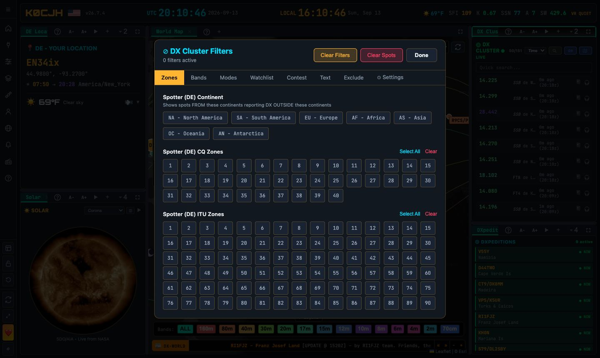

_The DX spot filter dialog: band, mode, continent, and more_

The funnel icon opens the DX Filter Manager. Filters combine with AND:

- **Zones** — continent, CQ zone (1–40), ITU zone (1–90)
- **Bands** — 160m through 70cm, including 60m, 11m, and opt-in 630m/8m/4m support where data exists
- **Modes** — CW, SSB, FT8, FT4, RTTY, PSK, and friends; mode comes from the spot comment when present, otherwise inferred from frequency against the band plan
- **Text** — search spot comments for keywords (TEST, SKCC, POTA…) with OR logic
- **Watchlist / Exclude** — always-show and never-show callsign lists
- **Contest / DXpeditions** — a contest filter and a one-click "show only DXpeditions" toggle cross-referenced against the DXpedition list
- **IOTA** — "show only IOTA spots" keeps spots whose comment names an Islands On The Air reference (EU-005, NA-067, "na067"…). The same filter is one click away on the **IOTA** button in the panel header, and because the map draws from the same filtered list it doubles as an IOTA map toggle. Tagged spots get a cyan **EU-005** badge in the DX Cluster and activation panels (hover for the island group name, from the bundled RSGB IOTA list) and an "IOTA EU-005 · Great Britain" line in their map popup.

All filter state persists in your browser.

### What you can do with a spot

- **Click** it — sets the station as your DX target and highlights the path on the map.
- **Tune** — with click-to-tune enabled and Rig Bridge running, your radio jumps to the frequency and the right mode (Yaesu rigs even get a proper band-select so antenna/ATU memories follow).
- **🎧 Listen** — no radio handy? The listen button opens a web SDR _already tuned_ to the spot. OpenHamClock picks the nearest live KiwiSDR with a free slot whose coverage includes the frequency, falling back to a curated list of long-running receivers, and finally to the KiwiSDR directory. Available on DX cluster rows, activation rows (POTA/SOTA/WWFF/WWBOTA), and callsign popups.
- **📓+ Log it** — opens the Logbook's new-QSO form prefilled from the spot. In layouts without a Logbook panel, the same button opens a small Log QSO pop-up instead, so log-from-spot works everywhere (the Contest layout keeps its own quick-log strip).
- **Callsign popup** — click a callsign anywhere for a station card: name, QTH with the DX end's local time, country, and a jump to your preferred callbook (QRZ.com, HamQTH, or QRZCQ — pick in Settings → Station). When the station has been spotted recently, the card also shows a one-line spot history — "Heard 14x today: 20m(8) 15m(4) 40m(2)" — straight from the server's in-memory cluster cache.
- **Send a spot** — spot a station yourself directly from the panel header; it goes out through the OHC cluster.

### Worked-before badges

Spots are cross-referenced against your QSOs (native logbook + N3FJP + N1MM feeds):

- **DUPE** — you've worked this call on this band and mode. Contesters, skip it.
- **WORKED** — the call is in your log, but not on this band+mode. Still worth a QSO.
- **NEW** — this spot's DXCC entity isn't in your logbook at all — an ATNO, flagged in red by the same live award tracking behind the Awards panel.
- **BAND** — the entity is in your log, but not on this band. A new band slot.
- No badge — the call isn't in your log, but it's nothing you're missing either.

Portable prefixes are normalized (`5Z4/OZ6ABL` matches `OZ6ABL`) and phone/digital submodes are collapsed sensibly (USB/LSB → SSB, PSK31/63 → PSK).

### Watch lists

Watch lists use a compact spec grammar and come in three independent flavours — one for DX cluster spots, one for activation spots (POTA/SOTA/WWFF/WWBOTA) and one for logbook rows. Edit them from the matching panel (DX Filter Manager → Watchlist, the activation filter dialog → Watch, the Logbook's **Watch** button) or all together in Settings → Station → Watch lists. Each list has a mode:

| Mode     | Effect                         |
| -------- | ------------------------------ |
| **Off**  | List is ignored                |
| **Red**  | Matches are highlighted in red |
| **Only** | Only matches are shown         |
| **Not**  | Matches are hidden             |

A list is a comma-separated set of _specs_; a spot matches the list when it satisfies **any** spec, and it satisfies a spec when it meets **all** of that spec's parts:

- **Bands** — `40M`, `70CM`, or a range `20-10M`
- **Sub-band modes** — `40CW`, `20SSB`, `30FT8`, `160-10CW`, `10-20DATA`; modes CW, DATA, FT4, FT8, RTTY and SSB are frequency windows from the band plan (the spot comment is never consulted — a CW spot at 14.200 is "20SSB")
- **Frequencies** in MHz — `14-14.02MHZ`, or a single `14.074MHZ` (±0.5 kHz)
- **Logbook keywords** evaluated against the native logbook — `NADXCC` (entity not yet worked), `NAPREF` (WPX prefix not yet worked), `NAGRID` (4-character grid not yet worked; the spot must carry a grid), `NABAND` (band not yet worked). With an empty log everything counts as new; an unresolvable entity or a spot without a grid never matches.
- **Prefixes** — `VP2E`, `3Y`, `K1`. Portable calls are split into a DX portion and a home portion the usual portable-call way: `/MM`, `/AM`, single characters, digit-only parts (`/7`) and 3+ letter parts without a digit (`/QRP`) are ignored, and of what remains the part that is not a full callsign (or the shorter one) is the DX portion. A plain prefix matches either portion; a prefix with a trailing `/` (`VP2E/`) matches the DX portion only.

Examples: `20M NADXCC` (new entities on 20 m), `40CW VP2E, 3Y/` (VP2E on 40 m CW, or any 3Y activity), `14-14.02MHZ NAPREF`.

An existing simple watchlist (the old list of callsigns) is migrated automatically into the DX list as prefix specs in Red mode (Only mode if "show only watchlist" was on). The watchlist alert feed (Settings → Alerts) follows the DX list.

In the DX Cluster panel, Red matches get a red callsign and row tint. When a Red match sits outside the visible part of the list, a red ▲ / ▼ button appears; click it to scroll to the match.

### Scrolling and the NEW indicator

While the DX Cluster list is scrolled away from the top it stays frozen — new spots are not inserted under your pointer. A green **NEW n** button counts the spots that arrived meanwhile; click it (or scroll back to the top) to resume the live list.

### Cluster login commands and the Cluster Console

With a **Custom Telnet Server** source (self-hosted installs only) you can add native cluster commands that OpenHamClock types once after each login, in order — for example `set/filter dxbm/pass 20,15`, `set/skimmer` or `set/dx/filter by_cont=EU`. Settings → Station → DX Cluster Source → Custom Telnet Server → **Cluster login commands**: up to 10 commands of one line each (120 characters, printable ASCII, no `bye`/`quit`), each with an on/off toggle so you can keep a command without sending it. The stock `sh/dx 25` + `set/dx` pair is always sent first. Changing the list on a live session sends the new commands straight away. HTTP sources (DX Spider Proxy, HamQTH, OHC Cluster) and UDP have no session, so the section explains that nothing is sent.

The **Cluster Console** panel (self-hosted; add it from the ＋ panel picker) shows the raw text of that telnet session — login banner, filter confirmations, `sh/dx` tables, WWV and announcements — the last 500 lines, refreshed every 2 seconds. The input line sends one command per second to the node, with the same validation as login commands. The panel is disabled with an explanation when the active source is not a telnet cluster, and it never opens a connection of its own: keep the DX Cluster panel in your layout, since that is what holds the session.

### Map spot labels

Settings → Map Layers → **Spot labels** chooses what the labels on DX cluster and activation markers show — **None**, **Callsign**, **Prefix** (WPX-style: `K0`, `VP2E`) or **Frequency** (MHz) — and a **Min label distance** in km (HamClock's "Min label dist"): markers closer to DE than that keep their symbol but drop the label, which keeps the area around your station readable. Hovering a DX spot still shows its callsign. The 3D globe shows labels on hover only, so these options apply to the flat and azimuthal maps.

### UDP spots: set DX, only mine

With the **UDP Spots** source (N1MM, DXLog, MacLoggerDX and friends broadcasting spots on port 12060), two options live under Settings → Station → UDP Spot Listener:

- **UDP spots set DX** — each newly received spot becomes the DX target (the batch already present at startup is skipped, so loading never moves your DX marker).
- **Show UDP spots: All / Only mine** — loggers rebroadcast every cluster spot they receive; _Only mine_ keeps just the spots whose spotter is your own callsign (SSIDs and portable suffixes ignored). "Set DX" follows this filter.

---

## The logbook

The Logbook panel is a native, no-account-needed log.

**Where your QSOs live — read this bit.** The log is stored in **your browser's IndexedDB**, on your machine. It comfortably handles 10k+ contacts and survives reloads and restarts — but it does **not** sync between browsers, devices, or the hosted site vs. a self-hosted install, and clearing the browser's site data deletes it. **Export ADIF regularly as your backup.** Private/incognito windows fall back to in-memory storage that vanishes when the window closes.

What it does:

- **Log a QSO** with the **+QSO** form — UTC date/time default to now, and frequency/mode prefill from your rig when Rig Bridge is connected.
- **Log from a spot** — the 📓+ button on any DX cluster or activation spot opens the form prefilled with call, frequency, mode, and grid. If the current layout has no Logbook panel, the button opens the same form in a small app-level pop-up instead — save, see the confirmation flash, and carry on (the Contest layout is the one exception: its quick-log strip stays the logging path there).
- **ADIF import** — bring in your existing log (`.adi`/`.adif`); duplicates are detected and skipped.
- **ADIF export** — your whole log as a standard `.adi` file, any time. This is your backup and your bridge to LoTW/QRZ/other loggers.
- **Worked-before everywhere** — the log feeds the DUPE/WORKED badges on spots, and the Awards panel (DXCC/WAZ/WAS/VUCC) and the Worked Grids map layer.
- **Full backup** — one JSON file with every QSO _and_ all your settings, from **Settings → Profiles → Full Backup** (details below). Once your log tops 50 QSOs, the panel shows a small dismissable reminder when your last backup is more than a month old — **Back up now** downloads the file on the spot.

QSO records are ADIF-aligned internally (band, mode, RST, grids, power, plus arbitrary extra ADIF fields), so round-trips through other software are clean.

### Group logging (Field Day)

For contests worked as a group — Field Day, club multi-station efforts — several stations can share one live merged log. Press **Group** in the Logbook panel's toolbar, or **👥 Group** in the Contest layout's header:

- **Start session** creates a shared session and shows an 8-character **invite code**. Read it to the other stations (or copy it into the club chat).
- **Join session** on the other computers with the code and each operator's callsign. Up to 25 operators per session.
- From then on, **every QSO you log syncs automatically** — from the +QSO form, log-from-spot, or the Contest layout quick-log; there is nothing extra to do at logging time. The Group section shows the merged log with each contact's operator, who's currently connected, and a live **DUPE** flag when two stations work the same call on the same band.
- The **Contest layout quick-log** is group-aware too: typing a call another station in the session already worked on the current band+mode shows a **GRP DUPE** badge naming that operator, before you commit the contact.
- **Export** downloads the merged log as ADIF (each contact carries the `OPERATOR` field), and **To my log** copies the merged contacts into your personal logbook (dupes skipped). Other operators' contacts never enter your personal log unless you press it.

The session lives on the server your OpenHamClock talks to (the hosted site, or your own self-hosted install — for a fully offline Field Day site, a laptop running OpenHamClock locally can host the session for the LAN). Anyone with the invite code can join, so treat the code like the tent: share it with your operators, not the whole band. Sessions expire after a week of inactivity; QSOs are capped at 10,000 per session, which comfortably covers a big Field Day.

### Logbook Sync (Wavelog/Cloudlog, QRZ Logbook, LoTW)

**Settings → Integrations → Logbook Sync** connects the native logbook to the loggers you already use. Everything is opt-in and per-user: your API keys and LoTW login are stored **only in this browser** (never on the server, never in backups or profile share codes), and each request carries your own credentials — so this works on the hosted site too, without sharing anything with other users.

- **Wavelog / Cloudlog push** — enter your instance URL, API key, and Station Profile ID (the **Test** button lists your profiles with their IDs). Every QSO you log in OpenHamClock is pushed automatically; failures go into a retry queue (capped at 100) that drains on retry or via **Push all unsynced**. The pending count shows in the card and in the Logbook panel footer.
- **Wavelog pull** — enable **Pull QSOs from Wavelog into this logbook**, use **Test** to select one or more Station Profiles, then **Sync now** for the initial import. After that, OpenHamClock incrementally pulls new QSOs into the native logbook. When the server is configured for Wavelog MQTT events, newly logged QSOs trigger an immediate incremental pull and grid-bearing contacts also appear on the **Logged QSOs (API)** map layer. The saved cursor prevents already-fetched QSOs from being downloaded again.
- **QRZ Logbook push** — uses a **QRZ Logbook API key** (Logbook → Settings on qrz.com; requires an XML subscription). This is _not_ the QRZ username/password used for callsign lookups. Same automatic push + retry queue.
- **LoTW confirmations** — **Sync LoTW confirmations** pulls your confirmed QSLs from Logbook of The World and marks matching local QSOs (call + band + mode + time within ±30 minutes) with a green **LoTW✓** chip. Syncs are incremental (only QSLs since your last sync) and rate-limited to once every 5 minutes — LoTW is slow, be patient with it.

Notes: only QSOs logged in OpenHamClock _while a push integration is enabled_ are queued — importing a 10k-QSO ADIF history won't spam your remote logbook. Editing an already-pushed QSO does not re-push it.

---

## Propagation in depth

### The engines

OpenHamClock runs **real ITU-R P.533-14 predictions** — the same physics as VOACAP-class tools — and it's honest about which engine produced what you're seeing (look for the engine badge in the panel header):

1. **WASM (the good one).** ITURHFProp v14.3 compiled to WebAssembly runs _in your browser_. Coefficient tables (~11 MB per month) download lazily and cache in IndexedDB. This is the steady state on the hosted site and on builds that include the WASM bundle.
2. **REST.** The ITURHFProp microservice, if the WASM engine can't run.
3. **EST (heuristic).** A rough model from SFI/Kp/path geometry, shown only as a last resort and clearly badged.

Digital modes are predicted at their true decode thresholds (FT8 −19 dB, FT4 −15, WSPR −26, JT65 −23, CW +5 vs a 3 kHz reference), so an SSB-dead path can honestly show 67% for FT8. Set your operating mode and TX power in **Settings → Station** (presets 5/25/100/1500 W, or a custom 0.1–2000 W in the panel), plus an antenna profile.

Real-time corrections come from ionosonde data via KC2G/GIRO — measured ionosphere, not just modeled.

### The views

- **VOACAP Chart** — 24-hour per-band reliability for the DE→DX path, with your actual local sunrise/sunset marked.
- **VOACAP Bars** — the same, for right now.
- **VOACAP Propagation Map** (layer, key V) — reliability from your QTH to everywhere, as a world heatmap.
- **MUF Map** (layer, key M) — maximum usable frequency contours from live ionosonde data.
- Panels can **auto-rotate** views on a timer (5–60 s) for kiosk displays.

Data acknowledgement: ionosonde data from prop.kc2g.com originates from the [Global Ionospheric Radio Observatory](https://giro.uml.edu) and its worldwide network of contributing stations.

### Measured beacon SNR (KiwiSDR beacon monitor)

Predictions are models; the 18 NCDXF/IARU beacons are the ground truth, transmitting 100 W CW on 14.100, 18.110, 21.150, 24.930 and 28.200 MHz in a fixed 3-minute rota. The **KiwiSDR beacon monitor** is a Rig Bridge plugin that listens to them for you around the clock through any KiwiSDR you own or may park on:

- Every 10-second beacon slot it retunes the Kiwi (CW, 300–700 Hz passband) to the beacon transmitting on the band whose turn it is, reads the receiver's S-meter during seconds 1–9 of the slot, and records SNR against a per-band noise floor (the median of the quietest 20 % of readings on that band over the last cycle). Bands rotate slot by slot, so with all five enabled every beacon/band pair is measured once per 15 minutes.
- Measurements stay in the bridge (24 h+, readable by the browser directly) and are also posted to your OpenHamClock server once per cycle, so a remote or hosted browser sees them too.

**Setup:** Settings → **Rig Bridge** → _Beacon monitor (KiwiSDR)_: enable it, pick a receiver (**Find nearest public receivers** lists the nearest Kiwis from the public directory with distance and free slots, or type a host and port), add the Kiwi's password if it needs one, choose the bands, then **Push to Rig Bridge** and **Save**. Rig Bridge restarts the monitor live; the same settings are also editable in the bridge's own setup page under Plugins. Prefer a Kiwi you own — the monitor holds one receiver slot continuously, public receivers often cap session length per IP, and the monitor then simply reconnects with backoff.

**Reading it:** the IBP Beacons panel's **MEASURED** view is an 18 × 5 grid — one coloured cell per beacon and band showing the latest SNR (grey = not heard, red → green = +6 … +30 dB, faded = older than an hour), a 24-hour heat strip per beacon (best SNR in each half-hour), and a **P.533** column: how many of that beacon's measured bands agree with the browser's own ITU-R P.533 prediction for the beacon→you path (100 W CW, the beacons' real power and mode). Hover anything for numbers. The **Prediction Check** panel gains the same data as a third, amber bar per band, and the **Alerts** tab offers a _Beacon Openings_ feed that sounds when a beacon on a band goes from unheard to ≥ 10 dB.

---

## Satellites

The Satellite Tracks layer (key **S**, on by default) tracks amateur satellites with SGP4 orbital mechanics computed in your browser.

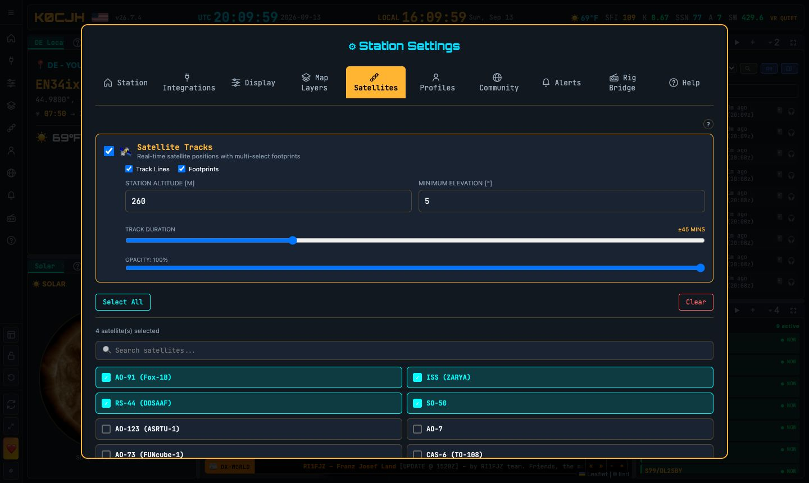

_Settings → Satellites: pick your birds, station altitude, minimum elevation, track duration_

- **Element sets** are fetched server-side from **CelesTrak**, **AMSAT**, and **SatNOGS** (each individually disableable in `.env`), with **Space-Track** available as the primary source if you add credentials. Multi-source failover means a rate-limited upstream doesn't blank your sky.
- **Pick your birds** in **Settings → Satellites**: search, select, Select All/Clear. Only selected satellites are computed — a real CPU saver on a Pi. Set your **station altitude** and **minimum elevation** (default 5°) for pass math.
- **Track duration** is configurable — the slider draws ±15 to ±120 minutes of orbit (default 45), and footprint circles can be toggled.
- **Click a satellite** for its info window: position, altitude, and when it's visible from your QTH — range, range rate (negative = approaching), and **doppler factor** (multiply your uplink/downlink by it to correct for motion), plus **next-pass countdowns** and a pass-prediction modal. The window minimizes to a compact icon.
- **On the 3D globe**, satellites orbit at true altitude with ground tracks and footprint rings; zooming in swaps dots for 3D models (real ISS model, procedural archetypes for the rest).

The tracked-satellite list is actively audited — dead and decayed birds get removed, new active ones added — so the catalog reflects what's actually usable.

Two dockable panels build on the tracking:

- **Satellite Passes** — one table of every upcoming pass for your tracked birds over the next 24 hours, sorted by AOS: countdown, start/end times, duration, compass path (e.g. SW→NE), and max elevation color-coded by quality. Passes in progress glow green with a LOS countdown. Uses your minimum-elevation setting.
- **AMSAT Status** — the community-reported AMSAT status board: which birds have been **Heard**, are **Telemetry Only**, or **Not Heard**, with report counts and recency. Passes tell you when the bird is up; this tells you whether the transponder is worth pointing at.
- **Satellite Planner** — pick one tracked satellite and see its elevation at DE _and_ at the DX target over the next 24 hours on one chart, with the windows where it is above your minimum elevation at **both** ends shaded green and listed underneath (start, end, length, peak common elevation, each station's own AOS–LOS). Click the chart for a point readout (elevations, sub-point, altitude); click a pass — or the readout's **Show on map** — to set the [display time](#time-shift) to that moment so the map, globe and footprints jump there. Same math as the EME layout's SAT mode.

### Satellite automation: Doppler tuning and rotator tracking

The Satellite Passes panel (and each satellite's info window, in both projections) carries two switches per satellite. Pick the bird from the panel's dropdown or by clicking a pass row.

- **DOPPLER** keeps your rig on the Doppler-corrected **downlink**. Choose the transponder or beacon from the **TX** dropdown — the list comes from the SatNOGS transmitter database and your pick is remembered per satellite. The tuner recomputes the range rate every second from the element set and sends a new frequency through Rig Control only when the correction has moved by more than the **Doppler retune step** (default 20 Hz), together with the transmitter's mode (FM, USB, LSB, CW). The readout shows corrected and nominal RX and TX frequencies live; the corrected **uplink** is shown for you to set by hand — Rig Bridge has no split/sub-VFO command, so only the downlink is tuned. Within the pre-position window before AOS the radio is parked on the AOS frequency. Needs Rig Control enabled (Settings → Rig Bridge).
- **TRACK** points your rotator at the satellite (azimuth and elevation when the rotator reports elevation). Before each pass it swings to the AOS azimuth (**Pre-position before AOS**, default 10 min). See [Rotator auto-track](#rig-control-and-rig-bridge) below for the rotator side, including flip mode for passes that cross the rotator's stop.

Both switches are also on the satellite info window: the Leaflet window on the flat map and the telemetry window on the 3D globe. Automation never resumes by itself after a reload — you switch it on each session.

### Sky view

The **SKY** tab of the Satellite Passes panel draws a polar sky plot of the selected satellite's next (or current) pass: zenith at the centre, horizon on the rim, N/E/S/W around the edge, with the AOS (green), LOS (red) and maximum-elevation points labelled with their times and a dot for where the bird is right now. A dashed path means the element set is stale (see below).

### Element-set age and Refresh TLEs

Predictions drift as element sets age. **Settings → Satellites → Max TLE age** (default 7 days) sets the limit: satellites whose elements are older are flagged **⚠ 3.2d** in the Satellite Passes list, in their info windows and in the picker, and their tracks are drawn **dashed** on both the flat map and the globe. **Refresh TLEs** (in the SKY tab and in Settings) asks the server to re-fetch every tracked satellite's elements now; the server accepts one forced refresh per 10 minutes and needs the write key on installs that set one.

### Pass alerts from hams.at

The **ALERTS** tab lists upcoming alerted passes announced on [hams.at](https://hams.at): satellite, operator callsign and grids, AOS/LOS, max elevation, mode/frequency and the comment, with **co-visibility** worked out against your own station — "co-visible 9 min · max 34°" means the bird is above your minimum elevation for nine minutes of that alert's window. Without a key you see the public feed; add your personal **hams.at API key** in **Settings → Satellites** to get your own alerts and hams.at's ranking. The key is sent only to your own OpenHamClock server, which forwards it to hams.at and never stores it (responses are cached for five minutes under a hash of the key). A self-hosted server can disable keyed proxying with `HAMS_AT_KEYED_PROXY=false`. The audio feed **Satellite Alerts (hams.at)** in Settings → Alerts sounds 15 minutes before an alerted pass and can raise a browser notification.

---

## Rig control and Rig Bridge

**Rig Bridge** is a small helper program that runs on the computer near your radio and translates between OpenHamClock and your hardware. Once it's running: click a spot, your radio tunes.

- **What needs it:** anything that touches hardware — rig CAT control, PTT/On-Air, APRS via a local TNC, rotator, MeshCom UDP, Winlink/Pat. The browser can't open serial ports; the bridge can.
- **What doesn't:** everything else in OpenHamClock works without it, hosted or self-hosted.

**Setup:** Settings → **Rig Bridge** tab → enable, download for your OS (Windows/Mac/Linux — requires Node.js and git), run it, and configure your radio in its local setup UI (default `http://localhost:5555`). Read [rig-bridge/README.md](../rig-bridge/README.md) first — it covers every radio and plugin in detail.

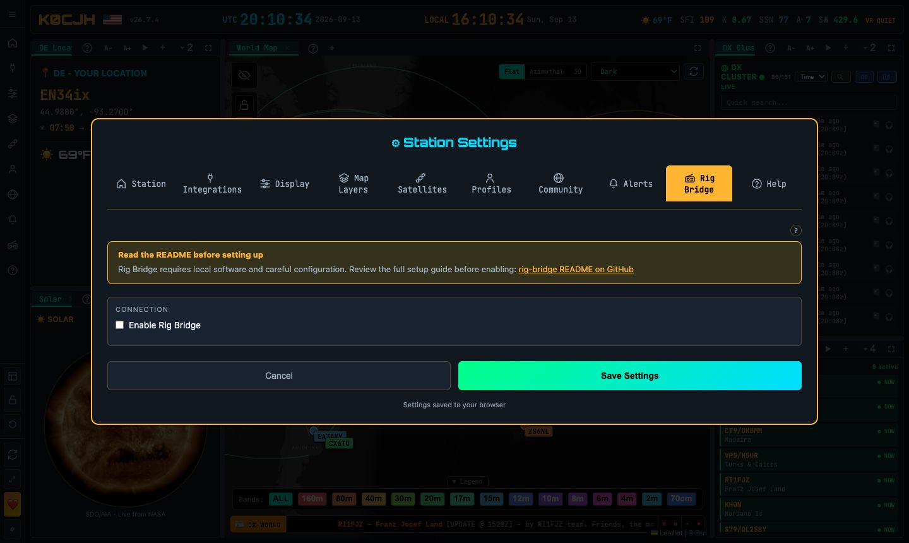

_Settings → Rig Bridge: enable, download for your OS, connect_

**Plugins at a glance:**

- **Radio:** Yaesu, Kenwood, Icom over USB; rigctld, flrig, TCI (Thetis/ExpertSDR), FlexRadio SmartSDR, RTL-TCP (RX-only)
- **Digital modes:** WSJT-X, JTDX, MSHV, JS8Call — bidirectional (reply to a decode, halt TX, set free text)
- **Packet:** APRS TNC (KISS/Direwolf), Winlink (Pat client)
- **Hardware:** Rotator (rotctld); Raspberry Pi hardware — GPS receiver, environment sensors (BME280), GPIO lines, light sensor / brightness (see below)
- **Monitors:** KiwiSDR Beacon Monitor — automated NCDXF/IBP beacon SNR logging through a KiwiSDR (see [Measured beacon SNR](#measured-beacon-snr-kiwisdr-beacon-monitor))
- **Cloud:** Cloud Relay

**Rotator auto-track.** The Rotator panel has an **AUTO** row with three modes:

- **OFF** — manual nudges and GO as before.
- **DX** — keep the antenna on the bearing to the current DX; the **SP/LP** toggle picks short or long path. Click a different spot and the rotator follows.
- **SAT** — track the satellite chosen in the picker (the same selection the Satellite Passes panel uses): azimuth and elevation while it is above the horizon, pre-positioned to the AOS azimuth before the pass. Satellites with no element set are not offered.

Commands go out at most once per second and only when the target has moved by more than the **Rotator step** (Settings → Satellites, default 2°). **STOP** halts the rotator and always drops back to OFF. The commanded azimuth is drawn on the map as a thin amber dashed beam next to the cyan live-bearing beam until the needle catches up (the MAP toggle controls both).

Two rotator backends are supported and picked automatically: Rig Bridge's **rotctld plugin** (azimuth + elevation; preferred when it is running and Rig Control is enabled in local mode) and the server-side **PSTRotator UDP** route (azimuth only; `ROTATOR_PROVIDER=pstrotator_udp`). The Rotator panel shows whichever is live.

**Flip mode.** Rotators whose elevation axis travels to 180° (Yaesu G-5500 and similar) can follow a pass that crosses the azimuth stop without unwinding through the stop mid-pass: set **Rotator elevation travel** to 0–180° and your **Rotator stop** (north or south) in Settings → Satellites. When the predicted azimuth path of a pass crosses the stop, the whole pass is run "over the top" — azimuth + 180°, elevation mirrored — and the panel labels it **flip**. Standard 0–90° rotators simply track through the stop.

**Cloud Relay (alpha):** using the hosted site or a cloud install? The relay connects your local rig-bridge to the server with a per-session token, enabling click-to-tune, PTT status, WSJT-X decodes, and APRS from anywhere. Connect it from Settings → Rig Bridge; the session credential lives only in your browser. Connect Cloud Relay also makes a **command key** that goes from your browser to Rig Bridge in the settings you paste, never to the server; Rig Bridge only acts on commands signed with it, so neither the server nor anyone who learns your session can tune or key your radio. The key also guards reading the relay: only your browser can follow your rig state, decodes and APRS through it. If Rig Bridge ever refuses a command from this browser, a notice says so and asks you to re-pair the Cloud Relay. If Settings → Rig Bridge says this browser has no command key (it was paired before keys existed), press **Disconnect Cloud Relay**, then **Connect Cloud Relay**, and paste the new settings into Rig Bridge: until you do, the relay still tunes until 31 January 2027 but PTT and transmit commands are refused.

**Click-to-tune behavior:** works from DX cluster, POTA/SOTA/WWFF/WWBOTA, PSK Reporter, and WSJT-X panels. "Auto-set mode" switches CW/SSB/Data from the band plan; Yaesu rigs get true band-select commands so ATU and antenna memories follow. With a US license class set in Settings → Station, tuning outside your privileges still tunes but shows a brief warning toast (e.g. "28.6 MHz SSB is outside Technician privileges").

(The older _Rig Listener_ and _WSJT-X Relay_ standalone tools still exist but are deprecated — Rig Bridge replaces all of them.)

### Raspberry Pi hardware (GPS, sensors, GPIO, brightness)

Four Rig Bridge plugins bring HamClock's Raspberry Pi hardware features to OpenHamClock. Enable them on the Rig Bridge setup page → **Plugins**; each one also has a **mock** mode so you can try the panels without any hardware. Wiring, Pi configuration and every setting are in [rig-bridge/README.md → Raspberry Pi Hardware](../rig-bridge/README.md#raspberry-pi-hardware-alpha). These plugins are alpha and were tested with mocks and unit tests, not yet on a Pi — reports welcome.

- **GPS receiver** (NMEA over USB/serial, gpsd, or a fifo/file). **Settings → Station → GPS** chooses what to do with it: **Off**, **Set once** (the first fix after start-up sets your lat/lon, grid and altitude — handy for a portable station), or **Follow** (rover mode, below). The same section shows the live fix and warns when the GPS time differs from your computer's clock by more than 2 s — a hint to fix the system clock; nothing is changed automatically.
- **Rover mode** — with Follow on, DE tracks the receiver and the **Rover (GPS)** panel shows the current 6-character grid, speed and heading, the distance to each grid line (N/E/S/W) with the ETA at your current speed and the grid on the other side, which edge your course crosses first, the VUCC status of the 4-character grid from your logbook, and how many QSOs you have already logged from this grid. QSOs logged while roving use the live grid as `MY_GRIDSQUARE`. Crossing into a new grid plays the **Grid Change (Rover)** alert (Settings → Alerts, with an optional browser notification).
- **Environment Sensors** panel — temperature, humidity, dew point and station pressure from one or two BME280/BMP280 sensors on the Pi's I2C bus (0x76 / 0x77, with per-sensor dTemp/dPres corrections like HamClock) and/or any HTTP JSON sensor (ESPHome, Tasmota, Home Assistant). Units follow Settings → Station. The panel shows the sensors side by side plus a 24 h history graph (temperature, humidity or pressure) kept in the bridge at one sample per minute.
- **GPIO** — header pins: a PTT/ON-AIR sense input lights the **On Air** panel (and the ON-AIR LED), buttons restart the **ID Timer** or silence its alarm, and outputs follow the countdown (green running / red expired), the alarm, and satellite passes (1 Hz pulse the minute before AOS, steady during the pass, 2 Hz for the last minute). The browser feeds the bridge its satellite and timer state automatically whenever rig control is enabled.
- **Lightning relay** — an optional GPIO output (`lightningOut`) that the [lightning guard](#lightning-guard) switches to disconnect an antenna or flip a coax switch while lightning is close. It is unassigned until you pick a line in **Settings → Rig Bridge → Lightning relay (GPIO)** (suggested BCM 25, header pin 22 — `P22` works too) and **Push to Rig Bridge**, or on the bridge's setup page; then tick **Drive the Rig Bridge lightning relay** in Settings → Alerts → Lightning guard. The relay engages at the alarm (or already at the warning) and releases at the all-clear. Rig Bridge keeps track of every display that reports: the relay stays engaged while **any** of them wants protection, and a display that goes quiet (closed tab, lost network) keeps its claim for its own all-clear time after its last request, so a closed tab in the middle of a storm never reconnects the antenna. **Run the guard inside Rig Bridge** (same card) makes the bridge watch Blitzortung itself, so the relay works with no browser open; it uses your location and your current guard settings (radii, all-clear time, hysteresis, repeat alerts, relay level), which every display that drives the relay sends along with its indicators — change them in Settings → Alerts and the bridge follows within seconds and keeps them across restarts. **Push to Rig Bridge** is only for the pin, fail-safe, hold and headless on/off. If the card says **Update Rig Bridge**, your bridge is older than these rules (it then follows only the most recent display and does not hold the relay by itself) — download the current version from the Rig Bridge tab or run the updater. Works through Cloud Relay as well. **Fail-safe** inverts the line so the relay is energised to keep the antenna _connected_: power loss, a crash or a stopped bridge then disconnects it. Wiring, relay choice and NC/NO contacts: [rig-bridge/README.md → Lightning relay](../rig-bridge/README.md#lightning-relay-lightningout). **This is a convenience, not lightning protection** — see the safety note under [Lightning guard](#lightning-guard).
- **Brightness** — an LTR-329 light sensor (or a lux value from an HTTP sensor) drives the display brightness through a two-point bright/dim calibration. With a controllable backlight (the official Pi touch display) the panel itself dims and the display schedule switches it off at night; otherwise OpenHamClock dims with a translucent overlay. **Settings → Display → Brightness** has the manual slider (works on any computer, no bridge needed) and the **Auto brightness** toggle.

---

## WSJT-X and digital modes

Decodes from WSJT-X, JTDX, or anything speaking the same UDP protocol appear live in the WSJT-X panel and on the map (when grids are known), including a WSPR sub-tab with SNR, drift, and power.

- **Same machine:** WSJT-X → Settings → Reporting → UDP Server → `127.0.0.1:2237`. Done (`WSJTX_ENABLED=true` is the default).
- **Another machine on your LAN:** set `HOST=0.0.0.0` in OpenHamClock's `.env` and point WSJT-X at that machine's IP, port 2237.
- **Multicast:** running several UDP listeners (GridTracker etc.)? Set `WSJTX_MULTICAST_ADDRESS` to match WSJT-X (e.g. `224.0.0.1`) — everyone shares the stream.
- **Cloud/hosted:** UDP can't cross the internet; use the Rig Bridge WSJT-X plugin (or the legacy relay agent with `WSJTX_RELAY_KEY`) to forward decodes over HTTPS, tied to your browser session.

Selecting a callsign in WSJT-X can auto-set your DX target, and clicking a decode tunes the rig to the correct dial frequency. PSKReporter integration is separate and automatic — see the PSK Reporter panel.

### Decoder panel: CW from your receiver

The **Decoder** panel (🎧, in the ＋ panel picker) listens to your receiver's audio right in the browser, shows it on a live waterfall, and copies CW — no extra decoding program needed. Everything runs on your own machine; no audio leaves the browser.

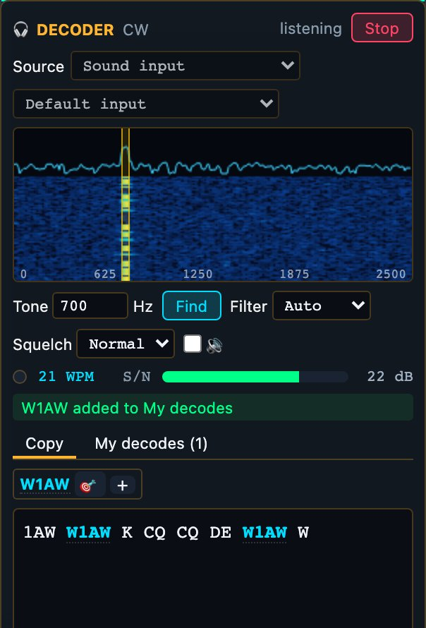

_The Decoder panel locked onto a 700 Hz CW signal: the yellow passband sits on the trace, the meters show 21 WPM and 22 dB S/N, and W1AW is clickable in the copy and in the chip above it._

**Pick a source**

- **Sound input** — any audio input the browser can see: the USB sound card built into most modern rigs, a SignaLink-style interface, a line-in, or (for practice) the microphone. Choose the device from the list (names appear after you have allowed microphone access once). The decoder turns off the browser's echo cancellation, noise suppression and automatic gain, which would otherwise chew up keying.
- **KiwiSDR (Rig Bridge)** — hear what a KiwiSDR hears. Turn on _KiwiSDR Audio (Decoder panel)_ in the Rig Bridge setup page (leave its host blank to reuse the beacon monitor's receiver), then enter a frequency in kHz and press **Start**; **← rig** copies your rig's frequency. The bridge connects to the Kiwi only while the panel is listening and lets go the moment you press Stop. This needs a direct connection to Rig Bridge — it does not work through the Cloud Relay.

**Tune and copy**

1. Press **Start**. The waterfall shows the audio from about 0 to 2.5 kHz (0–1.5 kHz for a KiwiSDR in CW mode); the yellow band is the decoder's passband.
2. **Click a trace** on the waterfall (or focus it and use ←/→, Shift for bigger steps) to put the passband on that signal, type a **Tone** in Hz, or press **Find** — the decoder listens for three seconds and locks onto the strongest keyed tone. With a KiwiSDR it runs Find for you right after starting.
3. Decoded text scrolls in the **Copy** tab. The meter row shows key-down (the dot), the measured speed in WPM (tracked automatically from 5 to 45 WPM, including Farnsworth spacing) and a signal-to-noise bar.

**Settings**

- **Filter** — _Auto_ narrows the detector as the sender slows down (better weak-signal copy) and widens it for fast senders; fixed widths of 50–300 Hz are there for crowded bands or drifting signals.
- **Squelch** — _Normal_ prints nothing from band noise; _Low_ digs deeper into weak signals at the cost of the odd stray E or T; _High_ only copies strong signals.
- **🔊** — play the audio through your speakers (handy with a KiwiSDR; leave it off with a microphone to avoid feedback).

**Callsigns in the copy** are highlighted. Click one for the callsign popup (with the frequency filled in when it is known from the rig or the KiwiSDR), or use the chips above the copy: 🎯 sets that station as your DX target (honours DX lock) and ＋ adds it to **My decodes** — a list kept on this device with the time (UTC), frequency, speed, signal and the line of copy it came from. Logging the same call on the same frequency within five minutes just updates its entry. From My decodes, 📻 tunes the rig to the decode (same as clicking a spot) and 🎯 sets DX.

**What it needs, and what to expect**

- A secure page: OpenHamClock over **HTTPS**, on **localhost**, or the desktop app. Browsers only allow audio capture there — opening a Pi's dashboard from another computer as `http://192.168.x.x` will show a notice instead.
- Clean machine-sent CW at everyday speeds (12–25 WPM) is copied essentially perfectly down to a signal-to-noise ratio of about −3 dB (in a 2.5 kHz bandwidth), and most of it still at −5 dB; fast senders (35 WPM and up) need a few dB more. Hand-sent CW with an uneven fist, heavy QSB and QRM cost accuracy, as with any machine decoder.
- **Try it without a radio:** play a CW practice recording (an MP3 from an online Morse trainer) out of a phone or speaker near your computer's microphone, choose the microphone, press Start and click the trace.
- It decodes CW only. For FT8, FT4 and the other WSJT modes keep using WSJT-X/JTDX and the WSJT-X panel above.

---

## The EmComm layout

A purpose-built dashboard for ARES/RACES/SKYWARN and served-agency work (Settings → Display → Layout → **EmComm**). Design principle: **local-first** — with a local TNC, the core functions work over RF alone when the internet is down.

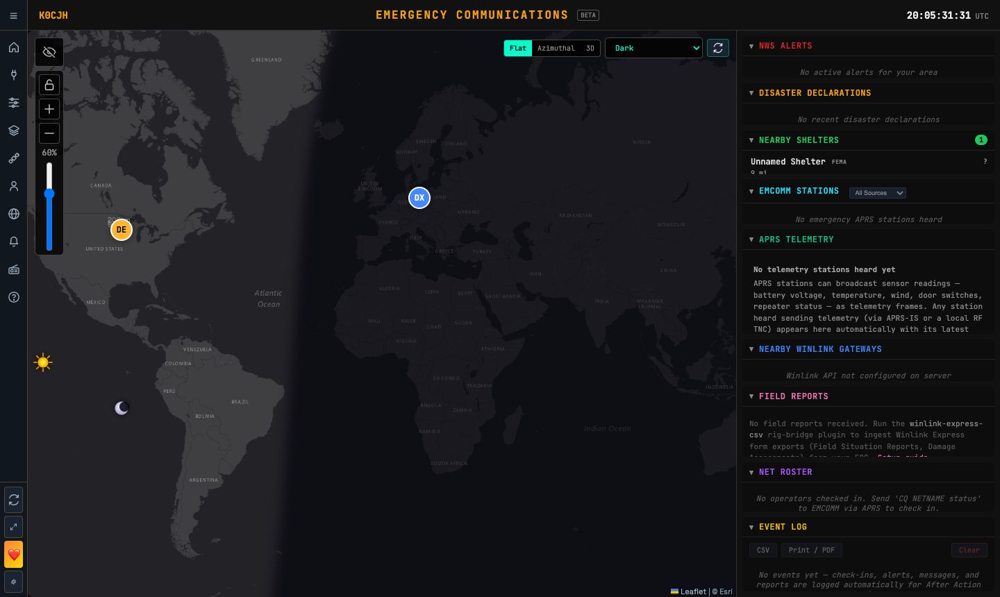

_The EmComm layout: map with range rings and alert polygons, and the operations rail_

- **Map:** range rings at 50/100/200 km, NWS alert polygons by severity, shelter markers, EmComm APRS stations, and an APRS source toggle (All / RF Only / Internet Only).
- **Panels:** Resource Summary (aggregated resource dashboard), NWS Alerts, FEMA Disaster Declarations, Nearby Shelters (with capacity, ♿ and 🐾 indicators — including shelter reports heard over RF), EmComm Stations, a live Net Roster, and [Net Control](#net-control-voice-nets) for running a voice net.
- **Net operations:** check in by APRS message (`CQ NETNAME <status>` to `EMCOMM`), check out with `U NETNAME`, or use the manual check-in API; the roster tracks status, last-heard, and resources.
- **Messaging:** point-to-point APRS messages (67 chars) from the roster's MSG button, sent via your local TNC.
- **Resource tokens:** structured data in APRS beacon comments — `[Beds 30/100][Power OK][Water -50]` — parsed into capacity bars, need flags, and the aggregate dashboard. Any `[Key Value]` works; built-ins include Beds, Water, Food, Power, Fuel, Med, Staff, Evac, Comms, Gen.
- **Telemetry:** APRS telemetry frames become per-station sensor dashboards with trend sparklines.
- **Winlink:** the gateway map layer and panel, plus Pat client messaging through rig-bridge. The **Nearby Winlink Gateways** list shows each gateway's predicted HF status chip (or a line-of-sight chip for VHF/UHF) and sorts by it, best first; the Winlink panel's **Reachable** view has the full detail (below).
- **Event Log:** significant events — net check-ins/outs, APRS messages sent and received, new NWS alerts, shelter and field reports, first-heard EmComm stations — are recorded automatically in your browser (capped at 2000). Export the log as **CSV** or a print-friendly **After Action Report** (with operator callsign, station location, and operation date range; use your browser's print dialog to save as PDF), or clear it between operations.
- **ICS Forms:** the **ICS Forms** section of the operations rail opens the standard incident paperwork, filled in from what the layout has already recorded. Incident name, operational period (UTC) and who prepared the form are typed once and shared by every form; everything is saved in your browser as a draft until you clear it. **Print / PDF** prints only the form, black on white, with its numbered blocks and page numbers (choose _Save as PDF_ in the print dialog for a file). The form is printed from its own clean page, so none of the dashboard's styling reaches the paper and every browser paginates it the same way (checked in Chrome, Firefox and Safari's WebKit); the 205 prints in landscape, and on a browser that ignores the page-orientation setting it is compacted to fit a portrait page. **Print labels in** chooses the wording on the printed form: **English (FEMA wording)** — the default, since agencies expect the standard labels — or the **Interface language**. The same panel is available in the Dockable layout as **ICS Forms**.
  - **ICS 309 Communications Log** — one row per event-log entry in the operational period: time (24-hour UTC), FROM and TO call signs with message numbers, and the message. Every piece of message traffic (APRS messages sent and received, net check-ins and check-outs — APRS and voice nets run in [Net Control](#net-control-voice-nets) — and ICS 213s) gets a station message number when it is logged; it prints under FROM Msg # for traffic you sent and TO Msg # for traffic you received. Numbers keep running from one operation to the next — clearing the Event Log does not restart them — and the 309 editor shows the next number. **Reset message numbers** (it asks first) restarts the station's numbering at 1; messages already logged keep their numbers. To number one operational period from your own starting point without touching the station's numbering, enter **First message # this period**. Every row can be edited before printing — time, call signs, numbers and text — and your edits are kept in the draft while new events keep arriving; **Add entry** adds traffic that never touched the app (a phone relay, a runner), ✕ removes a row and **Restore removed** brings removed rows back. Check-ins and check-outs, traffic passed on a voice net, APRS messages, ICS 213s, shelter and field reports are included by default; net opened/closed entries, NWS alerts and first-heard stations can be ticked in. Entries withdrawn with Net Control's **Undo** are left out; a withdrawn check-in keeps its message number, so the numbers after it don't change (you'll see a gap where it was). Also exports as **CSV**.
  - **ICS 214 Activity Log** — name, ICS position, home agency and resources assigned, plus an activity log you can **Import from event log** and then edit freely; add your own entries for anything that happened off the air. Re-importing adds only new events and keeps your edits.
  - **ICS 213 General Message** — to, from, subject, date/time, message, approval and reply blocks. **Send as APRS message** sends the subject and message to the _To call sign_ through your local TNC, split into numbered 67-character parts (`1/3 …`, `2/3 …`) when it is long, and records it in the Event Log (and so on the next 309). Each part shows whether it was sent; if the TNC drops part-way, **Resend remaining parts** picks up from the first part that did not go out, so nothing is sent twice, and the resumed send is logged too. The button is disabled while Rig Bridge reports no TNC.
  - **ICS 205 Incident Radio Communications Plan** — build the channel table from **Add from Repeaters** (the nearby repeaters, with output as RX, input as TX and the access tone), **Add from Nets** (your saved nets, plus the voice net running in Net Control right now, with its frequency, offset and tone read from what you typed; when its repeater offset is not known the TX cell says **offset?** and the remarks ask you to fill it in), **Simplex channel** rows, or **Import CHIRP CSV** (a CHIRP export of a radio's memories). Edit zone/group, channel number, function, name, assignment, RX and TX frequency, RX and TX N/W (narrowband 12.5 kHz or wideband — amateur FM is W), tones, mode (A/D/M) and remarks, reorder rows, and add special instructions. Pick a **Zone/group for new channels** to file what you add under it, and **Group by zone** to order the plan by zone. **CHIRP CSV** downloads the plan in CHIRP's generic CSV format to program radios: repeater offsets become `+`/`-` duplex, cross-band channels a split, a TX-only tone `Tone`, the same tone both ways `TSQL`, DCS codes (`D023N`) `DTCS`, and N/W picks NFM or FM.
- **Field Reports:** forms received at the station, newest first, each tagged with where it came from. **WINLINK:** Winlink Express at an EOC accumulates a CSV of received forms (Field Situation Reports, Damage Assessments) with embedded geolocation; point the rig-bridge `winlink-express-csv` plugin at that file and new rows appear. **NBEMS:** flmsg forms received over the air (ICS-213, radiograms, and other flmsg forms) picked up by the rig-bridge fldigi + flmsg plugin, listed as `ICS-213 (NBEMS)` and so on. Each entry shows form type, callsign, age, position, and text, and forms with a position become 📋 map markers. See the rig-bridge README for [Winlink Express](https://github.com/accius/openhamclock/blob/main/rig-bridge/README.md#winlink-express-csv-ingest-beta) and [NBEMS](https://github.com/accius/openhamclock/blob/main/rig-bridge/README.md#nbems-fldigi-and-flmsg-beta) setup.
- **NBEMS (fldigi + flmsg):** with the rig-bridge `fldigi` plugin switched on, the **NBEMS** panel shows fldigi's connection, mode (with a picker to change it), dial frequency, audio offset and TX/RX state, a live tail of the receive pane, and a send box that transmits through fldigi and returns it to receive when done (**Stop TX** aborts). The **ICS-213** button opens a compact form (to, from, subject, message) that goes out as an flmsg ICS-213 in fldigi's current mode, dated now in UTC, so the other station's flmsg opens it as a normal form; accented characters are sent as plain letters so the form's checksum passes on every computer. The panel works on the same network as Rig Bridge (sending uses your Rig Bridge API token when one is set) and on a hosted OpenHamClock through the Cloud Relay (commands are signed with the relay's command key; a browser paired before command keys existed must reconnect the relay to send).
  Received forms — including flmsg's compressed transfers — are read from flmsg's folders (`NBEMS.files/WRAP/recv` and `NBEMS.files/ICS/messages` in your home directory) and land in Field Reports within seconds. Your own drafts and sent forms stay out: flmsg records the sender in a form only when it is sent, and Rig Bridge compares that with your callsign (a plugin option can include them, tagged LOCAL). If no callsign is set in Rig Bridge or in flmsg, the panel warns, and sent forms saved in flmsg are listed tagged **ORIGIN?** because they could be yours or someone else's. An ICS-213 has no position field: write `GRID EM29qb` or `LAT 39.10 LON -94.58` in the message to put it on the map. Dates such as `03/04/26` are read the way your own flmsg is set to write them, or your computer's regional setting; a plugin option can fix the order for your net. Setup: [rig-bridge README](https://github.com/accius/openhamclock/blob/main/rig-bridge/README.md#nbems-fldigi-and-flmsg-beta).
- **Working without internet:** the **Offline Map Area** section in the rail saves the map tiles and the NWS alerts, shelters, repeaters, and (in the US) disaster declarations for your area ahead of time, so the map still draws and the panels show last-known data (tagged _Offline — as of 14:32Z_) when the connection is gone. The rail also lists **Nearby Repeaters**. See [Offline map areas](#offline-map-areas).

### Net Control (voice nets)

The **Net Control** panel is a logging desk for whoever is running a voice net on a repeater or simplex frequency. It sits in the EmComm rail and is also available in the Dockable layout (**＋ → Net Control**).

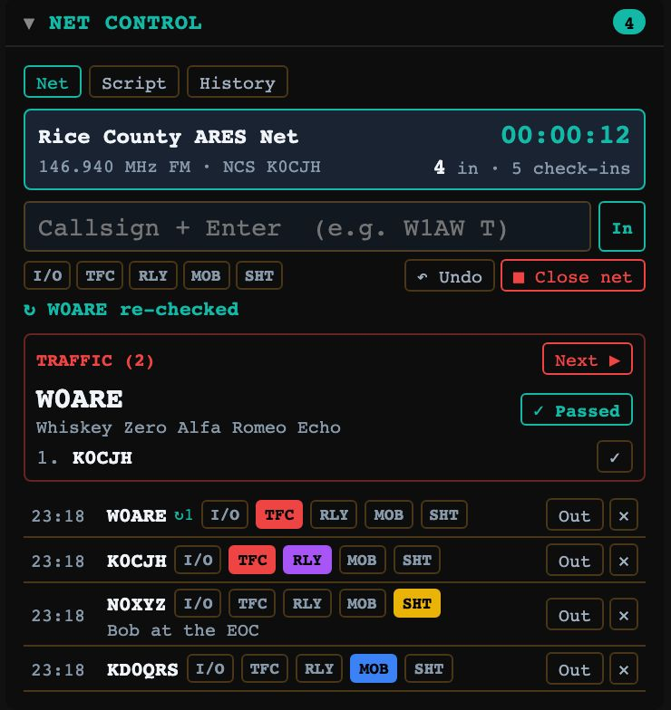

_Net Control in the EmComm rail: a running net with its timer and counter, the check-in box, the traffic queue, and the station list_

**Starting a net.** Pick a net from your [Nets](#station-and-rig) schedule (name and frequency fill in), or type a name and a frequency/repeater description, and confirm the net control callsign (your own call by default). **Start net** opens it: a running timer and a counter (stations currently in / total check-ins) sit at the top.

**Repeater offsets.** Type the frequency the way you would say it: `146.940 −`, `442.150 +5`, `53.700 − PL 100.0`. When you give only the direction (`−` or `+`), the panel uses the usual offset for that band in your part of the world, worked out from your station location: 600 kHz on 2 m, 1.6 MHz on 1.25 m, 5 MHz on 70 cm in the Americas (7.6 MHz in Europe), 100 kHz on 10 m FM. A line under the frequency shows the result (`TX 146.340 (−600 kHz standard)`). On 6 m in the Americas the panel follows the [ARRL band plan](https://www.arrl.org/band-plan): repeater outputs on 51.62–51.98, 52.5–52.98 and 53.5–53.98 MHz each pair with an input 500 kHz below. The plan allows local exceptions in the two upper segments, so there the line says **check locally**, as it does elsewhere a band plan varies. A 6 m frequency outside those output segments (a locally coordinated 1 MHz pair, for example) has no standard and shows **TX offset?**. Where there is no standard at all it shows **TX offset?** instead of guessing. Type the offset in the box beside it (`−0.6`, `+5`, `−500k`) to set or correct it; that entry always wins. The offset is used when the net is added to the ICS 205.

**Checking stations in.** The check-in box is built for keyboard speed: type a callsign and press **Enter**. Status flags go after the call as letters — **T** traffic, **M** mobile, **S** short time, **R** relay, **I** in-and-out — as a separate word (`W1AW T`, `W1AW TM`) or a slash suffix (`W1AW/M`). Use `/` or `+` for three or more letters (`W1AW /TMS`). Anything after the flags is kept as a note (`W1AW T Hiram, county EOC`). You can also click the flag buttons under the box, or press **Alt+T / M / S / R / I**, before pressing Enter.

- **Names and locations** fill in by themselves: first from stations you have logged on previous nets (instant, works offline), then from your logbook, then from the callbook lookup (the same QRZ/HamQTH path as the callsign popups) when the internet is available.
- **Duplicates:** pressing Enter twice on the same call within ten seconds is ignored with a warning.
- **Re-checks:** checking in a station that is already on the list moves it to the top and counts a re-check (↻). A station that had checked out comes back in.
- **Check out** with the **Out** button; the line stays on the list, greyed. **✕** removes a mistyped call.
- **Undo** reverses the last check-in, check-out, flag change, removal, or traffic pass (also **Ctrl+Z** with the check-in box empty). **Esc** clears the box. Anything already written to the event log stays there: Undo adds a "withdrawn" entry next to it instead, and the ICS forms leave both out. Removing a mistyped call withdraws its entries the same way, and undoing the removal reinstates them.
- Flags can be toggled on any line by clicking them.

**Traffic.** Stations flagged with traffic form a queue in check-in order. **Next** (or **Alt+N**) calls the first one, shown large with its phonetic spelling; **Passed** marks it done and records it in the EmComm event log. The ✓ beside a queued station passes it directly.

**Net scripts.** The **Script** tab holds named scripts, each a preamble and a closing for reading on the air, shown in large type; **Read aloud** fills the screen with it (click or Esc to close). Three come ready to use: **ARES weekly net**, **SKYWARN activation**, and **Tactical net**. Pick one from the list (or on the Start form; each net remembers its script), **Edit** to change the text or rename it, **New** for a blank one, **Copy** to start from an existing one, and **Delete** to remove one. The placeholders `{net}`, `{ncs}`, `{freq}`, `{date}`, `{time}` and `{count}` are filled in from the running net, with the time in your timezone setting and UTC. **Default** puts a ready-made script's text back. Your scripts sync and save to profiles like your other settings.

**Closing and the report.** **Close net** produces the net report: name, net control, frequency, opened and closed times, duration, total check-ins, unique stations, traffic listed and passed, and every station with check-in time, flags, name, and location. **Copy text** puts a plain-text version on the clipboard for email; **CSV** downloads a spreadsheet; **Print** opens a print-ready page (save it as PDF from the print dialog). Times are in UTC; switch the list beside the buttons to **UTC + local** to add your local time (from the timezone setting) to the copied text and the printed page. The CSV always has both, plus the timezone name.

**Where it goes.** Opening and closing the net, every check-in and check-out, and each traffic pass are recorded in the EmComm [Event Log](#the-emcomm-layout), so they appear in the After Action Report. While the net runs its stations also appear in the EmComm **Net Roster** alongside APRS check-ins (an APRS check-in for the same call takes precedence there); the closed net's station list stays stored in the same roster format for forms and reports.

**Reloads and history.** The running net is saved in your browser after every change, so a reload or a crash does not lose it. Closed nets are kept in the **History** tab (the last 50); open any of them to see its report again, or **Export all (CSV)** for one spreadsheet of every net. The running net and history stay in this browser and are not synced to other devices.

**Several tabs or panels.** Net Control can be open in more than one tab of the same browser (or in the EmComm rail and a Dockable panel). They stay in step: a check-in typed in one appears in the others, and closing the net in one closes it everywhere. A note under the tabs says **Also open in another tab or panel** while that is the case. If two of them change the net at the same moment, nothing is overwritten. When the two changes are about different stations (two different calls checked in, flags changed on different lines), both are kept automatically. Only when both changed the same station is the second change held back: that panel shows the latest net, names the station ("KE8PLM was changed in another tab too"), and keeps what you typed so you can check and press Enter again.

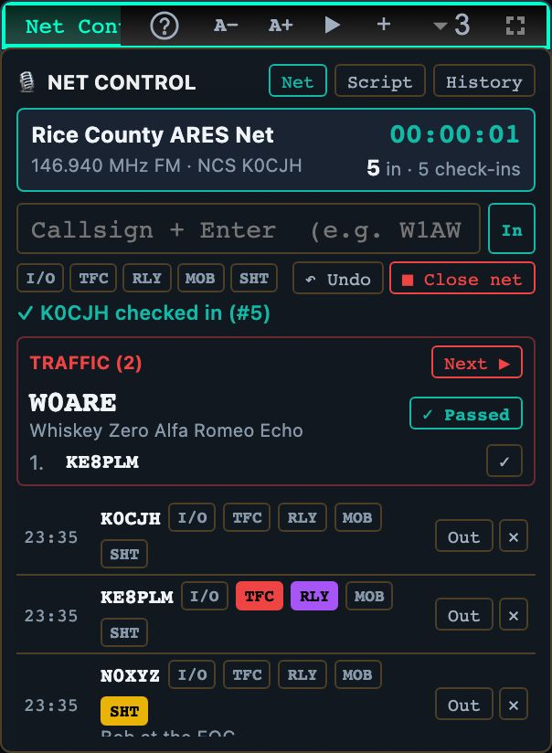

_Net Control as a Dockable panel_

### Shared incident: one picture for several operators and sites

On its own, each browser keeps its own event log and shows its own server's roster and reports. A **shared incident** puts everyone working the same activation on one operating picture: the net roster, the event log, field and shelter reports, a small incident board, the ICS form drafts, and the running voice net.

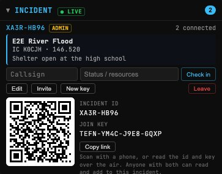

_The Incident panel for the incident's creator: live status, stations connected, the board, check-in, and the invite_

The **Incident** panel sits at the top of the EmComm rail. Its header shows the connection state (**LOCAL** when not joined, then **LIVE**, **CONNECTING**, **OFFLINE** or **ERROR**) and, once joined, how many stations are connected.

- **Create:** press **Create** and give the incident a name, the incident commander and the net frequency (all optional), plus an optional label for your site (e.g. "EOC North"). On the hosted site your callsign must be set in Settings → Station first. You become the incident's **ADMIN**.
- **Invite:** **Invite** shows the id, the join key (in groups of four, easy to read over the air) and a QR code. Scanning the QR code with a phone opens OpenHamClock in the EmComm layout with the Join form already filled in; **Copy link** gives the same link for a message. The key travels after the `#` in the link, so it never reaches a web server's logs.
- **Join:** press **Join** and enter the id and key (case and dashes don't matter), or open an invite link. With the join key you are an **OPERATOR**.
- **While joined:**
  - The Net Roster, Event Log, Field Reports, shelter markers and the map show everything every joined station has seen, merged without duplicates. Roster rows and log entries show which site they came from (`@EOC North`).
  - Your own server's APRS check-ins and check-outs, the events your browser records from the moment you join, and your field and shelter reports flow to the others within a second or two.
  - **Check in** (callsign plus status or resources) adds a voice or in-person check-in to the shared roster, and **OUT** on a roster row checks that operator out for everyone.
  - **ICS Forms** edit one shared set of 309/214/213/205 drafts. The 309 and 214 import from the shared log.
  - If your copy of the forms is out of date when it is sent (you were offline for an hour while another station kept editing), it is not saved over their newer version. ICS Forms shows theirs, with a banner: "W1AW saved these forms after your copy was made…". **Show differences** lists the fields that differ. **Apply mine** puts your copy on top of theirs. **Keep theirs** drops yours.
  - **[Net Control](#net-control-voice-nets)** runs one shared net. A net started at any station appears at every station, check-ins logged at one appear at all, and closing it closes it everywhere. If you were already running a net when you joined an incident that has none, yours becomes the shared net.
  - When two stations work the net at the same moment, both sets of changes are kept, the same way two Net Control tabs on one computer are. For example, North checks in W1AW while South flags K1ABC with traffic. Stations merged from two sites are listed newest check-in first, then by callsign, identically everywhere. If both changed the same station at the same moment, the change that reached the server last stands at every station (computer clocks don't matter). The station whose change was earlier sees which call it was and where it was changed ("W1AW was changed at EOC South too"). Your version is not lost: a **Your change** chip on that station (or above the list, for a net setting or a station no longer listed) shows it, with **Apply mine** to put it back and **✕** to keep theirs.
  - Withdrawing a check-in in Net Control hides it from every station's shared log.
  - **Message numbers** are per station. Your own messages keep your numbers. Another site's messages show as `SITE:12` in the shared log and on your ICS 309, and are never renumbered as yours.
  - The message history for a station (**HIST**) includes messages other sites sent to or received from it.
  - The Event Log's **CSV** and **Print / PDF** export the shared log. **Clear** is disabled, because the shared log belongs to the incident.
- **Admin tools** (the creator, or anyone holding the admin key):
  - **Edit** changes the incident board (name, IC, net frequency, notes) for everyone. Operators see the board but cannot change it.
  - **✎** and **✕** on shared Event Log and Field Report rows correct or delete an entry for everyone.
  - **New key** replaces the join key. Every operator is disconnected at once and sees the Join form with the incident id filled in. Give them the new key and they rejoin; anything they had waiting to send goes out then. Use this when a key has reached someone it shouldn't have.
  - **Show admin key** (under Invite) reveals the admin key. Give it only to a deputy, who can then join with it from another device. Any device that joined with the admin key can show the current join key under Invite. The server keeps the join key sealed so only the admin key opens it.
- **Losing the connection:** your updates queue up in the browser ("N waiting to send") and go out when the connection returns. Nothing is lost on a page reload, and nothing is duplicated when it reconnects. The last shared picture stays on screen while you are offline.
- **Leave:** **Leave** returns this browser to local-only operation. The incident carries on for everyone else. Your own event log, ICS drafts, running net and net history are exactly as you left them when you joined.
- **Several tabs:** every tab of the same browser follows the others. Joining, leaving or a new join key in one tab takes effect in all of them. The tabs share one queue of updates waiting to be sent, and only one tab sends it at a time, so nothing goes out twice.
- **Clocks:** a station whose computer clock is wrong can still share ICS drafts and the running net. The server decides which copy is newest by when it arrives, and so does a clash on the same net station.
- **Net history:** two stations closing a net at the same time both keep their closed net in the shared history.
- **Slow connections:** the tab sending the queued updates keeps the job for as long as the send takes, so a slow link does not lead another tab to send the same updates.

The server keeps incidents in `data/incidents.json`, so a restart does not lose an activation, and an entry the admin deleted stays deleted. A server restart also empties that server's APRS net roster; that is not treated as everyone checking out, but a roster that really empties is. An incident nobody has used for 7 days expires (sooner on a busy hosted server, and only while nobody is connected). The server stores only salted hashes of the keys, and the keys never appear in a web address. Anyone who has the id and join key can read and add to the incident, so share them the way you would share a net password. On the hosted site incidents cannot be listed or looked up without a key, and the limits are lower. For other tools, see the [shared incident API](API.md#shared-incident-api).

Deep dive: [docs/emcomm-roadmap.md](emcomm-roadmap.md).

### Reachable Winlink gateways

The Winlink panel's **Reachable** tab predicts which RMS gateways you can reach on HF this hour. It works from the public gateway list, so it needs neither Rig Bridge nor Pat (if this server has no Winlink API key, the list comes from the Rig Bridge Winlink plugin instead).

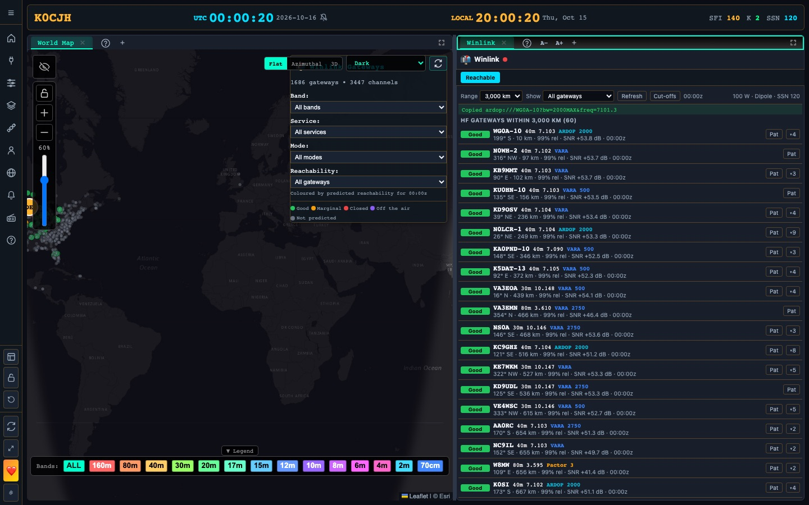

_The Reachable view: nearby HF gateways ranked by predicted reachability, and the map layer coloured to match_

**What the statuses mean**

- **Good** — on most days at this hour, the path to this gateway is open well enough for its mode to hold a connection. Expect to connect and move mail. A channel above the predicted maximum usable frequency (MUF) is never Good: the MUF shown is a monthly median, so the band reaches that high on half the days or fewer. Those channels show **above MUF** and are rated Marginal at best.
- **Marginal** — the path is open on some days, or it is just short of what the mode needs. Worth a try; expect slow speeds or a failed attempt.
- **Closed** — the path is very unlikely to work this hour. Try another gateway or come back later.
- **Off the air** — the gateway's own published schedule says it is not operating at this hour, whatever the propagation. Off-the-air gateways are never Good and never pass a reachability filter.

In numbers: the prediction gives a **reliability** — the share of days this hour that the path reaches the signal-to-noise ratio the gateway's mode needs to keep a link at its slowest speed — and an **SNR margin**, how far the expected signal sits above that need (more margin means faster speed levels). With the default cut-offs, Good is reliability of 50 % or more, and Marginal is 20 % or more, or an SNR margin of −6 dB or better. Change them with **Cut-offs** in the view (**Defaults** puts them back); the list re-sorts at once without new predictions.

- **What is predicted:** for every HF gateway within the chosen range (default 3,000 km; 500 km to 5,000 km) that is on the air at this hour, the app runs an ITU-R P.533 path prediction from your station to the gateway, on the gateway's own published frequencies, for the current UTC hour. It uses the power and antenna from **Settings → Propagation** and the current sunspot number. If you have shifted the display time, everything follows the shifted hour, including who is on the air. If the shift lands in another month, the prediction uses that month's sunspot number from NOAA's solar-cycle data (the measured smoothed value when it has been published, otherwise NOAA's forecast), and the header shows **(month)** next to the SSN.
- **Mode thresholds:** each mode is scored against the signal-to-noise ratio at which it can still hold a link. PACTOR 2 and 3, WINMOR, ARDOP, VARA 2300 and VARA 500 use −5 dB (in 3 kHz). That is the lowest level tested in Winlink's own channel-simulator comparison of these modes (May 2020, repeated after simulator corrections in July 2020), and every one of them still passed traffic there, so the real limit may be a little lower. ARDOP's developers measured the same −5 dB. Robust Packet uses the +7 dB from its published protocol description (typically 7–10 dB). VARA 2750 and HF packet have no published or measured figure and use marked estimates. The tooltip on each mode says which kind of figure it is. **My modem supports PACTOR 4** (under **Cut-offs**) scores PACTOR-4 gateways at the −19 dB the modem's maker publishes. Leave it off if your modem is PACTOR 3 or older, because a link only runs PACTOR 4 when both ends support it.
- **Operating hours:** gateways publish their hours in UTC (for example `00-23` for all day, `22-04` overnight, or `00-02,13-23`). Ranges that cross midnight are handled. Some gateways write `24/7`, which means all day. Others write `12/7` or similar, meaning about 12 hours a day without saying which hours; those, and free text such as `Other`, get an **hours ?** badge. They are still predicted, but may be off the air when you call.
- **The list:** each gateway shows a status chip, callsign, bearing and distance, band, frequency and mode of its best channel, reliability, SNR margin, and the time it was computed. Gateways are ranked Good, Marginal, Closed, then Off the air, by reliability within each. The ▾ button lists every channel of that gateway with its own prediction (off-air channels show their hours). **Show** narrows the list to predicted-reachable or Good-only gateways.
- **VHF/UHF gateways** (packet, VARA FM) within 300 km are listed separately by distance with a line-of-sight hint: up to 40 km is line of sight, up to 120 km needs height or a good antenna, and anything further is beyond line of sight. Nothing is predicted for them, but their hours still apply.
- **Actions:** click a gateway to set it as the DX target. When Rig Bridge rig control is connected, the click also tunes the radio to the channel's dial frequency in upper-sideband data mode, and each channel has its own **Tune** button. Winlink publishes the center frequency; the dial is 1.5 kHz lower for PACTOR, ARDOP and VARA HF, and equal to the published frequency for packet and VARA FM. **Pat** copies the connect string the way Pat's own gateway list writes it, e.g. `ardop:///W1AW-10?bw=2000MAX&freq=7099.7` or `varahf:///W1AW-10?bw=2300&freq=14107`, ready for `pat connect` or Pat's connect dialog. WINMOR and Robust Packet channels have no Pat button.
- **Map and EmComm:** the **Winlink Gateways** layer colors markers by predicted status whenever predictions exist. Its **Reachability** filter can ask for them on its own (with the layer on), so the panel does not need to be open. In the EmComm layout, the gateway list shows the same chips and sorts by them, and the gateway markers on its map are colored the same way. The panel, the layer and the EmComm layout share one set of predictions; they never compute the same gateway twice.
- **Performance:** predictions run in a background worker in your browser, two at a time, with a live progress bar; about 60 take a few seconds. Each refresh predicts at most 60 gateway/mode combinations. That budget is shared across distance bands (under 500 km, 500–1,000 km, 1,000–2,000 km and beyond, nearest first in each), so a busy local area does not crowd out the rest of the range; a note says how many gateways were skipped. Results are cached per gateway and hour. The view recomputes when your location, the hour, the range, power, antenna, the sunspot number or the PACTOR 4 setting change; **Refresh** forces a new run.
- **Without the in-browser engine:** the view asks the server for its band-level estimate instead (one request at a time, at most 20 per refresh). The estimate is for the displayed month and hour, with that month's sunspot number, so time shift works here too. 60 m and out-of-band (e.g. MARS) channels take the nearest band and are marked ≈. These estimates carry no SNR margin.

---

## The EME layout

A moonbounce operating dashboard (Settings → Display → Layout → **EME**). The map is pinned to the 3D globe (your saved projection for the other layouts is untouched) and framed so Earth and Moon share the view, with the **DE→Moon** and **Moon→DX** legs drawn between them: a leg is solid in its station's colour while that station can see the moon and turns dashed red once the moon drops below its horizon. The moon sits at a compressed distance (true scale is ~60 Earth radii, which would shrink Earth to a dot); the rail shows the real distance. **Frame Earth + Moon** re-centres the view after you have orbited away.

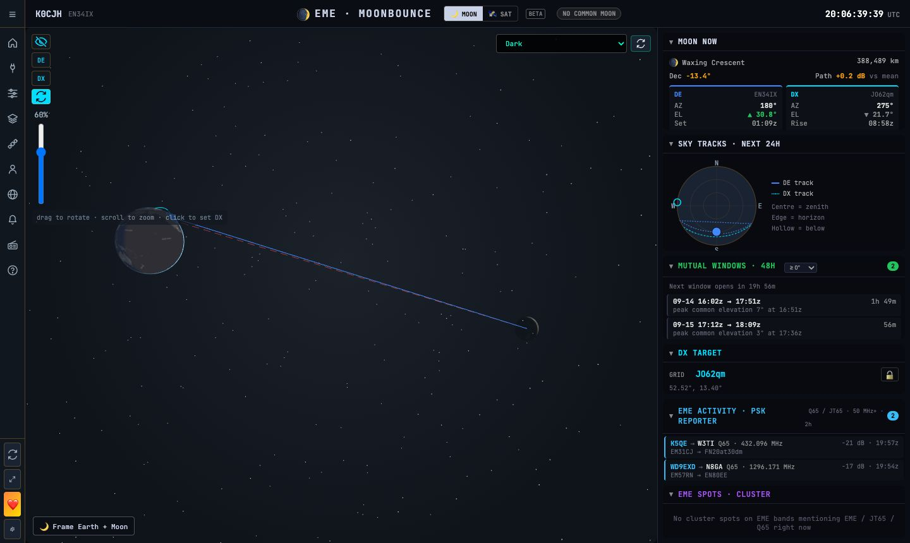

_The EME layout in MOON mode: Earth and Moon framed together with the DE→Moon and Moon→DX legs, moon readouts, sky tracks, mutual windows, and the PSK Reporter EME activity feed_

The rail:

- **Moon Now** — phase, distance, declination (positive is the northern hemisphere's friend), the two-way path-loss delta against the mean distance (loss goes with distance⁴, so the perigee–apogee cycle is worth about ±2 dB), and an az/el card for each end with the next rise or set.
- **Sky Tracks** — both stations' moon tracks for the next 24 hours on one polar dial (centre = zenith, edge = horizon), with each station's moon marker; hollow markers are below the horizon at their rising azimuth.
- **Mutual Windows** — the next 48 hours of windows where _both_ ends have the moon at or above the selectable minimum elevation, with duration, the peak of the lower elevation, and a countdown to the next one. The header badge turns green while a window is open.
- **EME Planner** — the same 48 hours as a chart: moon elevation at DE (solid) and DX (dashed) with the mutual windows shaded green and a red "now" cursor. Click any point for a readout — azimuth/elevation at both ends, Earth–Moon distance, the path-loss delta against the mean distance, and the round-trip echo delay — and **Show on map** to set the [display time](#time-shift) there. The table under it lists each window with its start, end, length, peak common elevation and the best (lowest) path-loss delta inside it. Also available as a dockable panel (**EME Planner**) outside this layout.
- **DX Target** — type a grid, click the globe, or pick a spot; lock it while you work a station.
- **EME Activity (PSK Reporter)** — every Q65 and JT65 report at 50 MHz and above from PSK Reporter's live feed over the last two hours, sender → receiver with mode, frequency, SNR and grids. Q65 is a VHF+ mode by design and JT65 above 6 m is EME, so this is where digital moonbounce activity actually shows up. Clicking a row sets the sender as the DX target. The server subscribes to the band-wide feed only while an EME layout is asking for it.
- **EME Spots (cluster)** — DX cluster spots on an amateur EME band (6 m and up) whose comment mentions EME, moonbounce, JT65, Q65, or QRA64. Clicking one sets it as the DX target.

### SAT mode: relay through a satellite

The **MOON / SAT** switch in the header swaps the moon for a repeater or transponder satellite. The globe shows only the selected satellite, at its true altitude with its footprint cone, and the legs run **DE→satellite→DX** with the same solid-or-dashed-red rule, judged against your satellite minimum elevation (Settings → Satellites). **Frame satellite** centres the view over its sub-point.

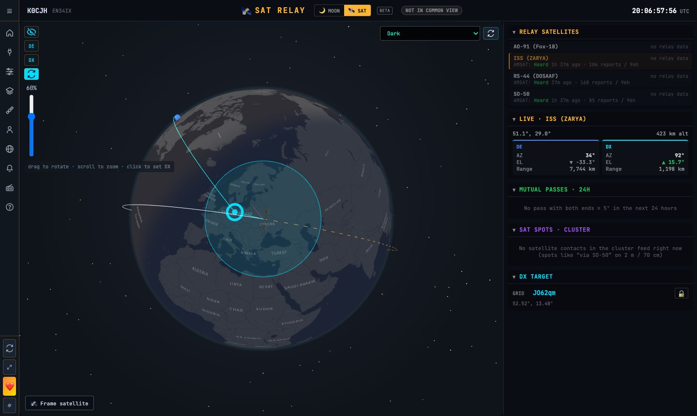

_SAT mode: the relay satellite at true altitude with its footprint cone, DE→satellite→DX legs, live look angles, and mutual passes_

- **Relay Satellites** — your tracked satellites that carry an active repeater or transponder (an uplink _and_ a downlink in the SatNOGS transmitter database), ranked by their next mutual pass with the current DX, with mode and frequencies. Satellites without relay data stay listed, greyed, so you can see what is tracked. Clicking one selects it.
- **Live** — the satellite's position and altitude, azimuth/elevation/range from both ends, and the Doppler-corrected uplink and downlink for _your_ end, updating every second. The header badge turns green with COMMON FOOTPRINT while both stations see it.
- **Mutual Passes** — the next 24 hours of passes where both ends have the satellite at or above the minimum elevation: the common window, its duration and peak common elevation, and each station's own AOS–LOS around it.
- **Sat Spots (cluster)** — satellite contacts in the DX cluster feed: spots on satellite bands whose comment names a bird ("via SO-50", "AO-91 FM") or says SAT. When the comment names one of your tracked satellites, clicking the spot selects that satellite and sets the DX target.
- Each relay candidate also shows its **AMSAT status board** line (Heard / Not Heard / Crew Active, last heard, report count) from the same feed as the AMSAT Status panel.

DX-side Doppler is deliberately not shown — that belongs to the other operator's radio.

## Alerts and notifications

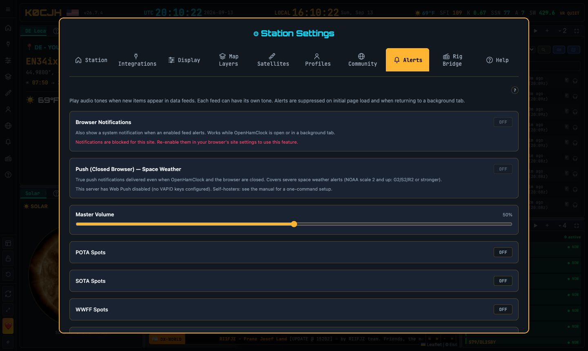

_Settings → Alerts: pick what wakes you and how_

**Settings → Alerts** plays a tone when new items appear in a feed. Feeds: POTA, SOTA, WWFF, WWBOTA, DX Cluster, Watchlist Hits, DXpeditions, Contests, Contest Starts, Satellite Passes, Band Openings, Space Weather, Beacon Openings, Grid Change (Rover), HamAlert, and Alarm Clock — all off by default, each with its own tone (nine Web Audio presets — no sound files) and a master volume. (The Alarm Clock entry only picks the alarm's tone and notification; an armed alarm always rings.) Lightning has its own card further down — see [Lightning guard](#lightning-guard).

Five event feeds go beyond "new item in a panel":

- **Watchlist Hits** — a spot matching your DX Cluster watchlist (Filters → Watchlist) appeared in the raw cluster feed. Matching happens _before_ your panel filters, so a watched call alerts even when the panel is filtered to something else, and portable calls match their base call (5Z4/OZ6ABL hits a watchlist entry of OZ6ABL). Re-spots of the same call on the same band stay quiet; the same call on a _new_ band alerts again — one alert per band opening.
- **Contest Starts** — strictly opt-in per contest: click the 🔔 next to a contest in the Contests panel to arm a reminder, and you'll get one alert when that contest is within 15 minutes of starting. With no contests armed, the feed stays silent even when enabled.
- **Satellite Passes** — one alert when a tracked satellite's next pass begins within 5 minutes, with the pass's max elevation.
- **Beacon Openings** — needs the KiwiSDR beacon monitor (Rig Bridge). One alert when an NCDXF beacon on a band goes from unheard to at least 10 dB SNR at your receiver — "15m VK6RBP heard +14 dB" — and quiet while the opening persists; a re-measurement every 15 minutes does not re-alert.
- **Grid Change (Rover)** — with a Rig Bridge GPS and Settings → Station → GPS → Follow, one alert each time the receiver crosses into a new 6-character grid square (the body names the new and the previous grid).
- **Band Openings** — the server watches RBN and cluster spot streams and flags surges against a 3-hour baseline, both per band and continent path and per band and CQ zone of the stations doing the hearing. A **Scope** setting picks what you are told about: **My CQ zone** (default — "20m opening EU→zone 3 (12 spots, 4x baseline)", so a West Coast station is not woken for an East Coast opening), **My continent**, or **Worldwide**. Your zone comes from your callsign; enter it by hand if your call's prefix doesn't match where you actually operate. One alert per opening episode; quiet while the baseline is still warming after a server restart.

Sensible guardrails: no alert storm on page load or when returning to a background tab, a per-feed cooldown, and one tone per batch of new items.

**Alarm clock.** A **daily** alarm and a **once-only** alarm, each set as HH:MM in your station's local time or UTC and armed or disarmed independently. Set them at the bottom of Settings → Alerts, or click the small **bell** in the header (grey = nothing armed, **green = armed**, red and pulsing = ringing) for the same editor in a popover; the Clock layout shows the same bell in its corner. When an alarm is due it rings the Alarm Clock tone repeatedly (up to 90 s), shows a red banner across the top with **Dismiss**, and sends a browser notification if notifications are on; the once-only alarm disarms itself after ringing. Alarms are stored in your settings (so they survive reloads and sync like everything else) and always run on real time, never on the time shift. In the Contests panel the **⏰** next to a contest sets the once-only alarm to that contest's start (click again to clear). Remote control: `window.dispatchEvent(new CustomEvent('ohc:set-alarm', { detail: { kind: 'daily', time: '06:30', utc: false, armed: true } }))` (`kind: 'once'` also accepts `at: '<ISO instant>'`).

**Browser notifications:** each feed also gets a 🔔 toggle to show an OS-level notification alongside the tone — delivered through the service worker, so they work while the tab is backgrounded. Grant permission with the master button at the top of the Alerts tab.

**Spoken alerts:** the **Speak Alerts** card at the bottom of the Alerts tab reads alerts aloud with your browser's text-to-speech (Web Speech API — no server, no account). A master toggle, a voice picker (whatever voices your OS/browser offers), a speaking-rate slider, **Spell callsigns phonetically** (ITU alphabet: "Watchlist: Victor Kilo Nine Mike Alfa on 20 metres CW"), and a per-feed checkbox for every feed — a feed must be enabled above _and_ ticked here to be spoken. Speech fires in the same place as the tone, so cooldowns apply; on top of that utterances are queued at most one every 4 seconds and identical sentences within a minute are dropped, so a burst of spots never stacks a minute of chatter. Hands on the paddles, eyes on the rig.

**Push with the browser closed:** the **Push (Closed Browser) — Space Weather** card in Settings → Alerts subscribes your browser to true Web Push. In this first version it covers one thing, broadcast to everyone subscribed: **severe space weather alerts** — NOAA scale **2 or higher** (G2/S2/R2 and up), the same threshold as the in-app severe-alert feed. A **Send test** button verifies the whole path end-to-end. Notes:

- Works on the hosted site out of the box. Push requires HTTPS and a service worker, so plain-http LAN installs can't use it (same browser rule as offline mode).
- **Self-hosters:** the feature is dormant until you configure VAPID keys — run `npx web-push generate-vapid-keys` once and set `VAPID_PUBLIC_KEY`, `VAPID_PRIVATE_KEY`, and `VAPID_SUBJECT` (a `mailto:` contact) in your `.env` (see `.env.example`). Without keys, the card simply shows push as unavailable and nothing else changes.
- Per-feed/per-watchlist push (your spots, your callsign) needs server-side evaluation and is planned as a later phase.
- **Lightning guard pushes** work on any server with VAPID keys and are opt-in per browser on the Lightning guard card (see [Lightning guard](#lightning-guard)): only subscribers whose own radius a reported strike falls inside get a push. Self-hosters running a server for themselves alone can set `PUSH_LIGHTNING_BROADCAST=true` to send every lightning report to every subscriber instead (the earlier behaviour); leave it off on a shared server.
  A reported strike reaches other subscribers only after the server has matched it against its own Blitzortung connection (opened only while someone has opted in; outbound WebSocket to `ws*.blitzortung.org`). Servers that cannot reach Blitzortung still deliver each station's own alerts to itself.

### Lightning guard

**Settings → Alerts → Lightning guard** watches real-time lightning from Blitzortung.org around your station and warns you before a storm arrives. It runs on its own — the **Lightning** map layer does not have to be on (both share one connection when it is). It replaces the former _Lightning Proximity_ tone (a fixed 30 km alert while the map layer was shown): if you had that switched on, the guard is switched on for you with the same tone, notification and speech choices.

- **Warning radius** (default 50 km) and **alarm radius** (default 25 km), measured from DE. A strike inside the warning radius raises a **warning**, one inside the alarm radius an **alarm**. **Strikes needed** (default 1) asks for that many strikes inside the radius within 10 minutes (or the all-clear time, if shorter) before a level is raised — raise it if isolated false detections bother you.
- **All-clear after** (default 30 min): the alarm ends only after that long without a strike inside the alarm radius; it then steps down to a warning if strikes inside the warning radius are still recent, or straight to all-clear. The same timer ends a warning.
- **Hysteresis** (default 20 %, 0–100 %): a level is _raised_ at its radius but _held_ by strikes that much farther out — the card shows the resulting hold radii (60 km and 30 km with the defaults) — so a storm sitting on the edge does not switch the alarm (and the relay) on and off. 0 % turns it off.
- **Alert again when lightning comes closer** (on by default): during an alarm the guard alerts once more when the nearest strike is at most half as far as at the last alert, or comes inside 10 km — at most once every 2 minutes. You hear "Lightning closer. Strike 6 kilometres north." and get a _Lightning closer_ notification and push.
- **Alert with:** a **tone** (one for a warning, three beeps for an alarm, a chime at the all-clear; pick the tone and preview it), a **spoken alert** ("Lightning alarm. Strike 12 kilometres north-east. Antenna relay engaged." — uses the voice and rate of the Speak Alerts card, but works without its master switch), a **browser notification** (needs Browser Notifications allowed at the top of the tab), and **Web Push** — see below. Screen readers get the same warnings, alarms and closer alerts through the app's live announcer. When the **EmComm** layout is active, every warning, alarm, closer alert and all-clear is also written to the EmComm event log for the after-action report.
- **On screen:** a ⚡ bolt next to the alarm bell in the header — grey all clear, amber warning, red and pulsing alarm, with a small **R** while the relay is engaged. Click it for the nearest strike (distance and compass direction), the time and distance of the last strike, how many strikes fell inside the warning radius in the last 10 minutes, the all-clear countdown and the relay state. While a warning or alarm is active a banner across the top repeats the essentials; **Hide** puts it away until the level changes.
- **Web Push (also with the browser closed):** available wherever the server has Web Push set up (the hosted site does). Ticking the box subscribes this browser if it isn't already (your browser asks for permission) and stores your station location — rounded to about 1 km — and your two radii with the subscription on the server; unticking removes them. When any station reports a strike, the server first checks it against its own copy of the Blitzortung feed (a matching strike within 5 km and 30 seconds; the server only listens while someone has opted in, and only keeps strikes near opted-in stations). Only a confirmed strike is pushed to others: the server works out for every opted-in subscriber whether it falls inside _their_ radius and pushes only to those, worded for their location — so a neighbour's guard can warn your phone too. A report the server can't confirm (made up, or its own feed is briefly down) goes back to the sender only. Each subscriber gets at most one push per level every 10 minutes, plus one when the level rises or the strike is at half the distance; reports are rate-limited. The all-clear and simulated strikes only go to your own browser.
- **Antenna relay:** tick **Drive the Rig Bridge lightning relay** and choose whether it engages at the **alarm** (default) or already at the **warning**. Needs Rig Bridge enabled — directly or through **Cloud Relay** — with the GPIO plugin running and a relay line assigned (see [Raspberry Pi hardware](#raspberry-pi-hardware-gps-sensors-gpio-brightness)). It releases automatically at the all-clear. If this browser goes away mid-storm, Rig Bridge keeps the relay engaged for your all-clear time after the last request; with several displays the relay stays engaged while **any** of them wants protection and is released only when none does. Optionally Rig Bridge can run the guard **itself**, so the relay is protected with no browser open at all; it follows the settings on this card automatically (see [Raspberry Pi hardware](#raspberry-pi-hardware-gps-sensors-gpio-brightness)). The header popover (and the settings card) has a manual override: **Auto**, **Force protect** (engage now, stays until you change it) and **Hold connected** (keep the antenna connected through this storm — it wins over other displays and ends by itself at the next all-clear, so it cannot be forgotten for the next one).
- **Test it without a storm:** **Simulate alarm strike** / **Simulate warning strike** on the card place a fake strike inside the alarm or warning zone; it runs the whole chain — tones, speech, notification, banner, EmComm log, the relay and a test push to your own browser — and appears on the Lightning map layer. Remote control: `window.dispatchEvent(new CustomEvent('ohc:inject-lightning', { detail: { distanceKm: 10, bearingDeg: 45 } }))` (or `detail: { lat, lon }`).

> **Safety:** the lightning guard is a convenience, not a safety device. Lightning data can be late, incomplete or missing, and the browser, the network, Rig Bridge or the Pi can fail. It does not replace proper grounding and bonding, surge arrestors, and disconnecting antennas by hand when a storm is forecast. Never rely on it to make outdoor antenna work safe.

---

## Home automation (MQTT and Home Assistant)

OpenHamClock can _publish_ to an MQTT broker so the rest of your shack automation — Home Assistant, Node-RED, a dashboard on the wall — can react to space weather, band openings and your rig. Two independent publishers, both off by default:

**Server (self-hosted only):** set `MQTT_PUBLISH_URL` in your `.env` (for example `mqtt://192.168.1.10:1883`, `mqtts://…` or `wss://…`), optionally `MQTT_PUBLISH_USER` / `MQTT_PUBLISH_PASS`, and `MQTT_PUBLISH_PREFIX` (default `openhamclock`). The server then publishes retained JSON topics, each at most once per minute and only when something changed:

| Topic                    | Content                                                                                             |
| ------------------------ | --------------------------------------------------------------------------------------------------- |
| `<prefix>/spaceweather`  | `sfi`, `ssn`, `kp`, `a_index`, `xray_class`, `bz`, `solar_wind_speed`, `proton_flux`, NOAA `scales` |
| `<prefix>/alerts/swpc`   | the latest SWPC alert products (count, max level, slim list)                                        |
| `<prefix>/band-openings` | current band openings and zone openings from the server's spot-surge detector                       |
| `<prefix>/status`        | `state: online/offline` (LWT), version, uptime, subsystem health — the availability topic           |

Set `MQTT_PUBLISH_HA_DISCOVERY=true` and the server also publishes retained Home Assistant discovery configs under `homeassistant/sensor/openhamclock_*/config`, so SFI, SSN, Kp, A, X-ray class, Bz, solar wind, G/R scale, alert count, open-band count and server health appear as entities of one "OpenHamClock" device without any YAML. `GET /api/mqtt/status` shows whether the publisher is enabled and connected (no credentials are exposed). The hosted site does not publish MQTT — this needs your own server.

**Rig Bridge (any install, including the hosted site):** the **MQTT Publish (Home Assistant)** plugin in Rig Bridge → Plugins publishes your rig's frequency, mode, band and PTT, rotator azimuth/elevation (when the Rotator plugin is enabled) and a running count of APRS packets received by the TNC plugin to `<prefix>/rig` and `<prefix>/rotator`, with `<prefix>/bridge/status` as the availability topic and the matching Home Assistant discovery entities (Rig Frequency/Mode/Band, PTT and Connected binary sensors, Rotator Azimuth/Elevation, APRS Packets Received). PTT changes are pushed immediately, everything else is throttled to one publish per second plus a keepalive every minute. Enter the broker URL, credentials and prefix in the plugin's fields and save — no bridge restart needed. The `mqtt` npm module is an optional dependency of Rig Bridge: prebuilt binaries include it; if you run from source and the plugin logs that the module is missing, run `npm install mqtt` inside `rig-bridge/`.

Typical automations: dim the shack lights when PTT goes on, a wall tablet card showing "20m open to EU", or a notification when the server's G scale reaches 3.

---

## Offline mode (PWA)

OpenHamClock is an installable PWA with a real offline mode:

- After one online visit, the app shell and assets are cached. Offline, the app loads and panels show their **last-known data** (API responses are cached network-first). Live streams obviously need a connection.
- When a new version deploys, the fresh worker installs in the background and a small **"Update ready — Reload"** toast appears. Click it and you're on the new version — no more mid-session forced reloads.
- **Limitations:** service workers require a secure context. On the hosted site (HTTPS) and `localhost` everything works; a self-hosted install reached over **plain http on a LAN IP** silently skips offline mode (that's a browser rule, not ours). The Electron app updates via its installer instead.
- **Escape hatch:** load the app with **`?nosw`** in the URL (e.g. `https://openhamclock.com/?nosw`) to unregister the worker and clear its caches — handy if a bad cache ever wedges things. Remove the parameter and reload to re-register.

**Install it on a phone or tablet.** In Safari use Share → **Add to Home Screen**; in Chrome use the menu → **Install app** (or **Add to Home screen**). The installed app opens full screen in its own window, and the [Mobile layout](#layouts-settings--display) is built to fit around the notch and home bar in that mode.

Separately from the PWA, the app polls the server version and — on the hosted site — reloads automatically when a new release lands.

### Offline map areas

The app shell and panel data above survive an outage on their own, but the basemap normally comes from tile servers on the internet. An **offline map area** saves the map for an area ahead of time — together with the EmComm data for it — so the map still draws when the internet is gone.

Find it in **Settings → Map Layers → Offline map areas**, or in the **Offline Map Area** section of the EmComm layout's rail. Both show the same control and the same saved list.

1. **Area:** a radius around your DE location (**25**, **50**, or **100 km**), or **Map view** — whatever the flat map is showing right now.
2. **Basemap and zoom:** only basemaps whose terms allow saving an area for offline use are offered (table below), plus your own tile server if you add one. Pick the one for the country you are in. Zoom defaults to **z6–z12** (region down to main roads and towns); z14–z15 adds street-level detail but multiplies the size by about four per extra level.
3. **Check the estimate:** the tile count and approximate size appear before anything downloads (around Boulder, CO: 50 km at z6–z12 is about 300 tiles and 9 MB; 25 km at z6–z15 about 4,000 tiles and 110 MB). One area is capped at 10,000 tiles.
4. **Download area for offline:** a progress bar shows tiles and bytes. The download keeps running if you close Settings. It is deliberately paced — a few tiles at a time — and tiles already saved by another area are not fetched again.
5. **Cancel** pauses: the tiles saved so far are kept and the area is listed as **Incomplete — _n_ of _total_ tiles saved** with a **Resume** button, which fetches only what is missing. The same happens if the browser runs out of storage, the tile server stops answering, or you close the tab mid-download.

Each saved area lists its name, basemap, zoom range, tile count, size, date, bounds, and what EmComm data it holds, with **Show** (switches the map to the area's basemap and centres it there), **Refresh data**, and **Delete**. Deleting keeps any tiles another saved area still uses.

**Basemaps that can be saved.** Each is published by a national mapping agency under an open licence that allows copying the map, and its terms do not forbid fetching an area ahead of time at a polite rate. The attribution shows on the map while it is in use.

| Basemap                  | Coverage                                           | Source and licence                                                                                                |
| ------------------------ | -------------------------------------------------- | ----------------------------------------------------------------------------------------------------------------- |
| USGS Topo                | United States (coarse world data elsewhere)        | U.S. Geological Survey, The National Map — U.S. public domain                                                     |
| Plan IGN (France)        | France and overseas territories, world at low zoom | IGN Géoplateforme, Plan IGN v2 — Licence Ouverte / Open Licence 2.0 (Etalab); the WMTS service has no usage limit |
| GSI Standard (Japan)     | Japan                                              | Geospatial Information Authority of Japan (地理院タイル) — GSI Content Terms of Use / Public Data License 1.0     |
| Kartverket Topo (Norway) | Norway                                             | Kartverket — CC BY 4.0, "© Kartverket"                                                                            |
| GA Base Map (Australia)  | Australia (tiles to z16)                           | Geoscience Australia National Base Map — CC BY 4.0, © Commonwealth of Australia; includes OpenStreetMap data      |

Not offered, because their terms do not allow it: the Esri, Google, and CARTO styles; OpenStreetMap's own tile servers (offline use is explicitly not permitted); OpenTopoMap (free use only as long as there are no mass downloads); and swisstopo (its terms send bulk use to a separate download service).

**Your own tile server.** Under the saved list, **Use my own tile server** takes a tile URL template — for example an mbtiles server (TileServer GL, mbtileserver) on the shack Pi or the LAN, a club server, or a commercial account whose terms allow offline storage. Give it a name, the highest zoom it serves, and the attribution to show, and tick the box confirming that you run the server or that its terms allow downloading areas for offline use — **you are responsible for following the source's terms**. Well-known public servers whose terms forbid it (OpenStreetMap's tile servers, Esri, Google, CARTO, OpenTopoMap, swisstopo, and a few commercial providers) are refused. After a reload it appears in the map's basemap list and in the offline-area basemap choice. The server must send CORS headers (`Access-Control-Allow-Origin`). If OpenHamClock is opened over HTTPS, the tile server must be HTTPS too; a plain-http LAN tile server only works when OpenHamClock itself is opened on `localhost`. The source is stored in this browser only.

**What happens offline.** When a tile request fails, the browser reports no connection, or the tile server stops answering for a few seconds, the map is drawn from your saved areas, and a small **OFFLINE TILES** tag appears at the top of the map. When the connection returns, tiles come live again and the tag goes away. The map has to be on the basemap the area was saved with — use **Show** or the style dropdown. Zooming in past the area's top zoom shows the area's deepest tiles scaled up (soft, but readable) for up to six levels; panning outside the area shows blank tiles. (Scaling up needs a browser that can draw in the background worker — current Chrome, Edge, Firefox, and Safari 17 or newer; older browsers show blank tiles there.)

**EmComm data in each area.** Every download also saves the current **NWS alerts** (with their polygons), **nearby shelters**, **repeaters** within 200 km, and — for an area in the United States — the **FEMA disaster declarations** for your state (the state is looked up from your DE location while you are still online, and shown in the list, e.g. "declarations (CO)"). When those requests fail, the EmComm layout's NWS Alerts, Disaster Declarations, and Nearby Shelters panels and the Repeaters panel show the newest copy available — either the last response the app cached or the area's saved copy — tagged **Offline — as of _time_** (UTC). **Refresh data** re-saves them; do it before an operation, since alerts in particular go stale quickly.

**Storage.** Pick a budget for saved areas (100 MB to 2 GB, default 250 MB); a download that would exceed it is refused until you delete an area or raise the budget. The control also shows how much storage the browser allows this site, warns when a download would bring it close to the limit, and refuses when the browser is nearly full. The app asks the browser to keep this storage persistent and says so when it is not granted; browsers may still clear site data under heavy disk pressure or when you clear browsing data, so check your areas before you rely on them. If storage fills up mid-download, the download stops and the area is kept as incomplete (see step 5).

**Caveats.**

- **Secure context required.** Offline map areas use the same browser features as offline mode: they work on the hosted site (HTTPS) and on `localhost`. A self-hosted install opened over **plain http on a LAN IP** cannot use them — the browser does not allow offline storage there. Put the install behind HTTPS (or open it on the machine itself as `localhost`) to use this feature.
- **Served by the offline worker.** Areas can be downloaded as soon as the page is secure, but they are only drawn from once the offline worker is active — after one full load of the app. The control says so when it is not.
- **Per browser.** Areas live in the browser that downloaded them; download them on the device you will operate from.
- **Safari, and every browser on iPhone and iPad.** WebKit deletes everything a site has stored — saved areas included — when the site has not been opened for 7 days of browser use, and may cap storage at around 1 GB. Add OpenHamClock to the Home Screen (iOS/iPadOS) or the Dock (macOS Sonoma or later) and open it from there; installed web apps are exempt from the 7-day rule. The control shows this warning in Safari.
- **`?nosw` keeps your areas.** The escape hatch clears the app's caches but not saved areas; delete those from the list.
- **Leaflet from a CDN.** Installs without the self-hosted map library (`scripts/vendor-download.sh` not run) load it from a CDN; the offline worker keeps a copy of that too, so the map still starts offline.

---

## Layouts, themes, and profiles

### Layouts (Settings → Display)

| Layout          | Best for                                                                                                                              |
| --------------- | ------------------------------------------------------------------------------------------------------------------------------------- |
| **Modern**      | Widescreen monitors — responsive 3-column grid around the map                                                                         |
| **Classic**     | Dedicated displays and Pi kiosks — the original HamClock look, refreshed                                                              |
| **Tablet**      | 7–10" widescreen displays (16:9)                                                                                                      |
| **Compact**     | 4:3 and smaller screens — data-first                                                                                                  |
| **Dockable**    | Power users — every panel draggable, tabbable, resizable; layout lock; reset button                                                   |
| **EmComm**      | Emergency communications operations (beta)                                                                                            |
| **Contest**     | Contest operating — quick-log strip, dupe check, rate meter, session multipliers                                                      |
| **Activator**   | In the field: POTA self-spotting, activations, RBN "am I being heard", nearby repeaters — park/summit map overlays switched on        |
| **Clock**       | A big digital clock and nothing else — UTC and local with seconds, the date, your callsign and grid. Shack TVs during down time       |
| **Hunter**      | Chasing activators: DX cluster, every activation program, sun & moon — spot overlays and DX paths switched on                         |
| **Weather**     | Radar, lightning, natural-hazard, and aurora overlays on a big map, with terrestrial + space weather panels                           |
| **Air Traffic** | Live aircraft and ATC sector overlays over a dominant map, with the Aircraft Nearby list and world clocks                             |
| **EME**         | Moonbounce and satellite relay on the 3D globe — DE→Moon→DX or DE→satellite→DX legs, mutual windows and passes, activity feeds (beta) |
| **Mobile**      | A phone or tablet as the main display — compact header, a touch-sized map, and swipeable panel cards. Go-boxes and the field          |

<table>
<tr><td width="50%" valign="top"> Modern</td><td width="50%" valign="top">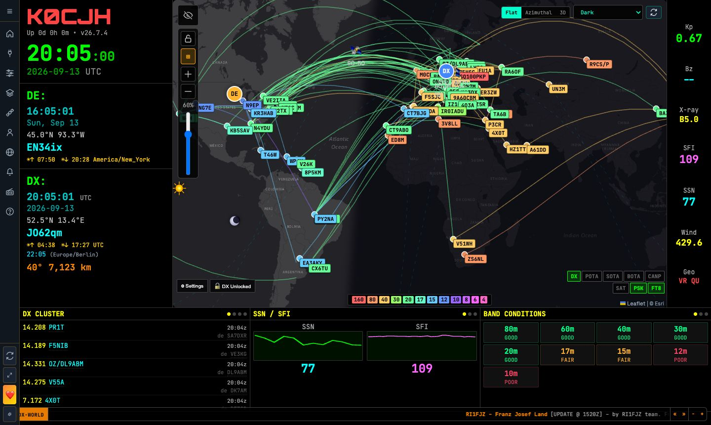 Classic</td></tr>
<tr><td width="50%" valign="top">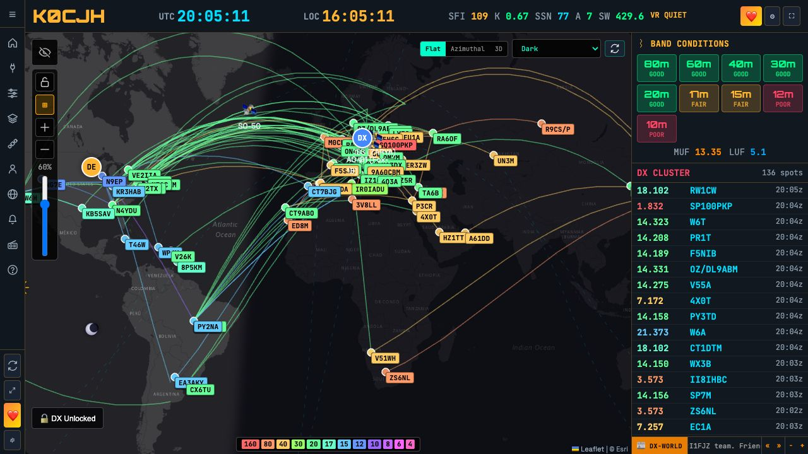 Tablet</td><td width="50%" valign="top">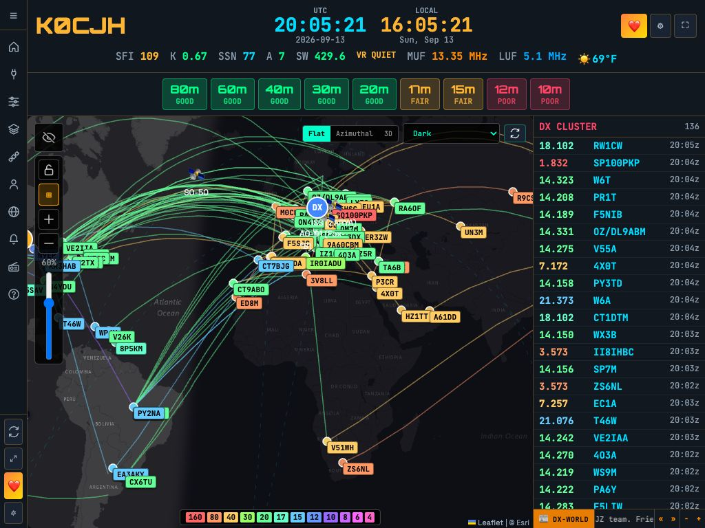 Compact</td></tr>
<tr><td width="50%" valign="top"> Dockable</td><td width="50%" valign="top"> EmComm</td></tr>
<tr><td width="50%" valign="top">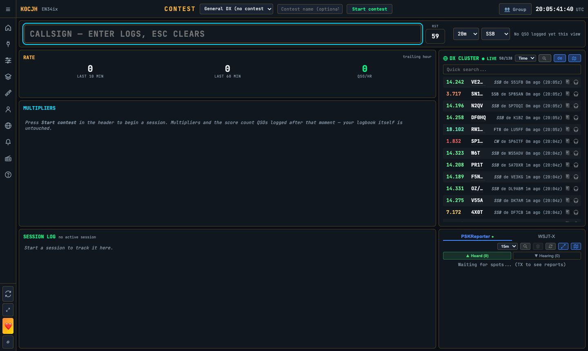 Contest</td><td width="50%" valign="top"> EME</td></tr>
<tr><td width="50%" valign="top">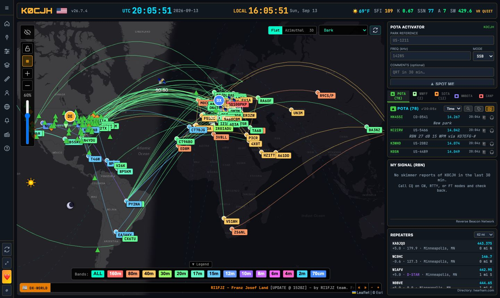 Activator</td><td width="50%" valign="top">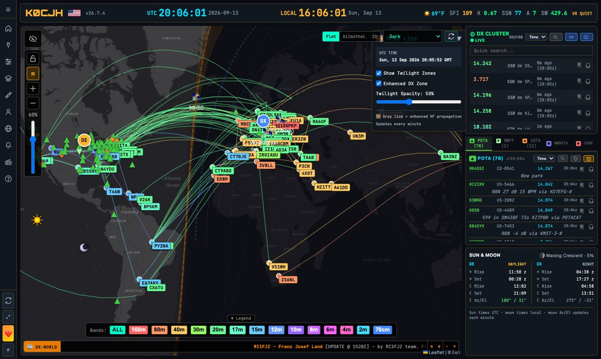 Hunter</td></tr>
<tr><td width="50%" valign="top">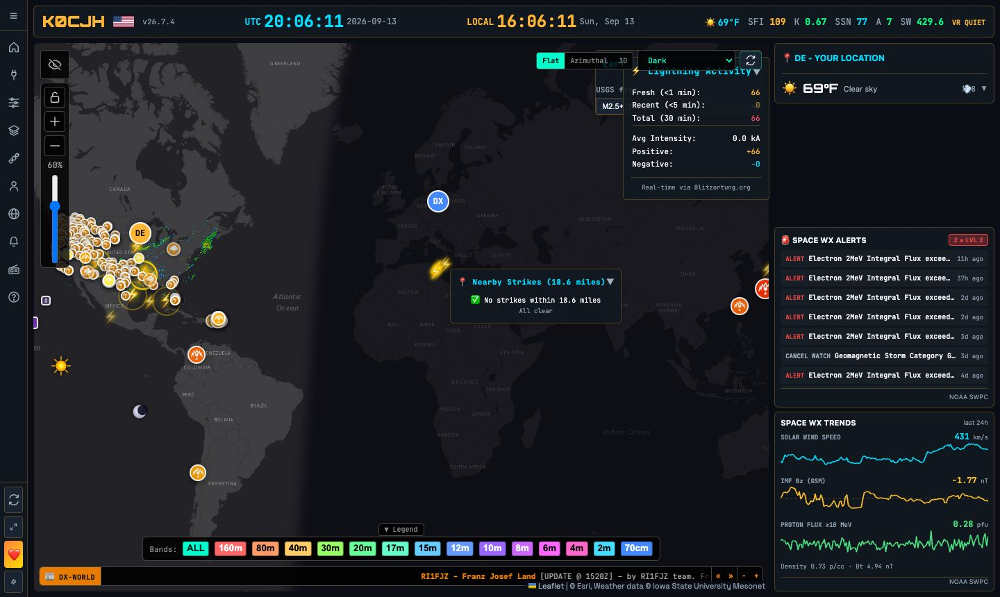 Weather</td><td width="50%" valign="top">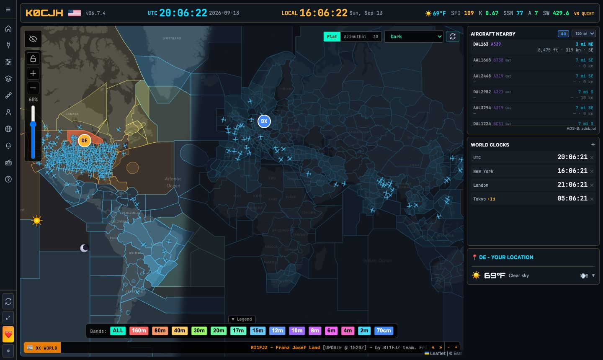 Air Traffic</td></tr>
</table>

The four focus layouts (Activator/Hunter/Weather/Air Traffic) fully reset the overlays each time you switch into one: the layout's own preset is applied exhaustively, and when you leave, your previous layer setup is restored exactly as it was.

**Named dockable layouts.** The Dockable layout can hold more than one arrangement. In the sidebar's layout controls (next to the lock and reset buttons), **⧉ Duplicate** saves the current arrangement as a named preset — up to 10 — and the dropdown switches between them live. Rename (✎) and delete (✕) manage your presets; the built-in **Default** is your original layout and can't be renamed or deleted. Presets are included in profiles, backups, and settings sync like everything else.

**Mobile layout.** Built for a phone or small tablet that _is_ the station display — in a go-box, on a picnic table at a park, or clipped to the dash. Pick **Mobile** in Settings → Display. On a phone's very first visit the app picks it for you while the first-run Settings dialog is open (change it right there on the Display tab if you prefer another); if your station is already configured on the server, so Settings doesn't open, the app offers it once instead — answer either way and it won't ask again.

- **Portrait.** A compact header on top: your callsign (tap it for Settings), UTC with seconds, a gear button, and on the second line your local time (tap it to flip 12/24-hour) followed by one line of chips — SFI, K (green, amber at 4, red at 5+), SSN, A, and the local temperature. If the chips don't fit, that one line scrolls sideways; the page itself never does. The map sits below at a usable height with phone-sized controls (see [Map controls on a phone](#map-controls-on-a-phone)): the map lock, zoom, the moon button for night shading, the map menu for projection (flat, azimuthal or 3D globe) and basemap, a **Bands** chip for the band filter, and the eye button that hides the map controls when you just want the picture.
- **Panel cards.** Under the map is a row of cards you swipe left and right: **DX Cluster**, **POTA / SOTA**, **Propagation**, **Solar**, **Satellites**, **Logbook** (with **+QSO**), **Weather**, **PSK / WSJT-X**, and **APRS** whenever the APRS map layer is on. Panels hidden in your saved configuration are left out, the same as in the Modern layout. The dots underneath show where you are — tap one to jump straight to that card. The app remembers the last card you looked at.
- **Choose your cards.** The **☰** button left of the dots opens the card list: tick the cards you want and untick the ones you don't (the last card can't be switched off). **EmComm** is an extra card, off unless you tick it — or on by default if you came to the Mobile layout straight from the EmComm layout. It shows the NWS alerts near your location (worst first; tap one for its instructions), the nearest shelters with distance and open/full/closed status — including shelter status reports heard over APRS, marked **RF**, shown on the matching FEMA shelter or as their own entry — and the APRS net roster with who is active. It only fetches while it is on screen or next to it, so leaving it off costs nothing.
- **Full screen.** The **⤢** button right of the dots opens the card you're looking at full screen; on cards without their own heading (Satellites, Weather) tapping the card's title bar does the same. **‹ Back** (or your phone's back gesture) returns to the map.
- **Landscape.** Turn the phone sideways and the header becomes a single row, with the map on the left and one card on the right — swipe or tap the dots to change it.
- **Notches and home bars.** Content stays clear of the notch, the rounded corners and the home indicator, with 16 px side margins, and works down to 360 px wide. Installed to the home screen (see [Offline mode (PWA)](#offline-mode-pwa)) it runs full screen with no browser bars. On Android, outside the installed app, a full-screen button sits next to the gear.
- To save data and battery on a phone, only the card you're looking at and its two neighbours are running; the others start when you swipe to them.

**Clock layout and the idle clock.** The **Clock** layout is a full-screen digital clock in your theme and font: UTC very large with seconds, local time beneath it (tap the big time to swap which one is large — the choice sticks), the date, and your callsign and grid in the corner. Pick it like any layout, add it to a Scene Rotation, or let it appear on its own: Settings → Display → **Idle Clock** shows it after 2 to 60 minutes with no input, and the first touch, mouse movement or key press brings the previous layout straight back. The idle clock never interferes with a Clock layout you chose yourself, waits while a dialog is open, and turning it on turns Scene Rotation off (and vice versa) so the two never fight over the screen.

**Scene rotation.** For shack TVs and club-station kiosks: Settings → Display → **Scene Rotation** cycles automatically through layouts you select, at an interval from 30 seconds to 10 minutes. Rotation pauses whenever a dialog is open and whenever someone touches the screen, mouse, or keyboard (it waits for 60 seconds of quiet before rotating again). While rotating, a small dot sits in the bottom-right corner and the new layout's name flashes briefly on each switch. Named dockable presets appear in the rotation list as "Dockable — _name_", so a kiosk can cycle through several dock arrangements; the plain "Dockable" entry keeps whichever preset is currently active. Saved profiles appear as "Profile — _name_" scenes too: rotating into one restores that profile's complete configuration (theme, layers, filters, layout — everything) and reloads the page, while your rotation settings carry over so the cycle keeps going. Because profiles live only in the browser that saved them, a profile scene is silently skipped on any device that doesn't have it.

### Contest mode

A dedicated single-screen layout for contest weekends — no map, maximum information density, and everything one keystroke away.

_The Contest layout: quick-log strip, rate meter, multipliers, and the cluster pane_

- **Quick-log strip.** A persistent callsign box sits right under the header. As you type, it renders an instant verdict for the current band+mode: **DUPE** (already worked on this band+mode), **WKD** (in the log, but not on this band+mode), or **NEW** — plus a **NEW ENTITY** / **NEW BAND** flag when the call's DXCC entity would be an all-time or band new one. Press **Enter** and the QSO is logged straight into the native logbook with the rig's current frequency and mode (or the manual band/mode picks when no rig is connected), the box clears, and focus stays put for the next call. **Esc** clears without logging. RST defaults follow the mode (59 phone / 599 everything else), and QSOs flow to Wavelog/QRZ push if those integrations are on.
- **Contest picker.** A select in the header chooses the contest, and the quick-log strip grows the right exchange columns for it — labeled, validated, and cty.dat-autofilled where possible: **CQ WW DX** (RST + CQ zone, zone autofilled from the callsign), **CQ WPX** (RST + serial), **ARRL DX** (RST + a smart State/Power field — a state or province maps to ADIF `STATE`, a wattage to `RX_PWR`), **ARRL Field Day** (class + section), **ARRL Sweepstakes** (serial + precedence + check + section), **IARU HF** (RST + ITU zone or HQ society, zone autofilled), **NAQP** (name + state/province), plus **Generic serial** and the default **General DX** (RST only — the original behavior). Contests that need your own sent values (my zone / class / section / precedence-check / name) collect them once in a compact setup row before logging enables; serial contests show your auto-incrementing sent number (recomputed from the session log, so it survives reloads). Every logged QSO carries the full ADIF contest mapping — `CONTEST_ID` (mode-correct, e.g. `CQ-WW-CW` vs `CQ-WW-SSB`), `STX`/`SRX` serials, `STX_STRING`/`SRX_STRING` composites, and the specific fields ADIF defines (`CQZ`, `ITUZ`, `CLASS`, `ARRL_SECT`, `PRECEDENCE`, `CHECK`, `STATE`, `MY_CQ_ZONE`, …) — so the ADIF export drops straight into a log checker. Switching contests mid-session warns first; logged QSOs are never modified.
- **Rate meter.** QSOs in the last 10 and 60 minutes, the extrapolated hourly rate, and a trailing-hour sparkline in 5-minute buckets.
- **Session multipliers.** Click **Start contest** in the header (name optional) to drop a session marker. From then on the multiplier tracker counts the chosen contest's multiplier dimensions worked since that moment, overall and per band — CQ zones **and** DXCC entities for CQ WW, WPX prefixes (standard prefix rule: `K5AB`→K5, `PJ2/W9WI`→PJ2) for WPX, sections for Sweepstakes, states/provinces for NAQP and the DX side of ARRL DX, ITU zones/societies for IARU — using the same cty.dat resolution as the Awards panel. The default General DX pick keeps the original DXCC + zones + states trio. The **score estimate** is QSOs × multipliers — still an estimate, since real contests apply per-QSO point values (Field Day has no mults, so its score is plain QSOs and sections show as info). **Stop** only clears the marker: every QSO stays in the shared logbook.
- **Spot-and-pounce.** The right side is a full-height DX cluster pane — the same worked/dupe/NEW badges from [Worked-before badges](#worked-before-badges) do the heavy lifting — with the PSK Reporter / WSJT-X panel below it. Click a spot to tune the rig **and drop its callsign into the quick-log strip** with the exchange autofilled and the first exchange field focused — work them, type the exchange, Enter. The 📓 log-this-spot buttons feed the strip the same way in this layout.

The session marker syncs and profiles like any other setting, so a mid-contest browser restart (or a second screen on the same instance) picks up where you left off.

### Themes (Settings → Display)

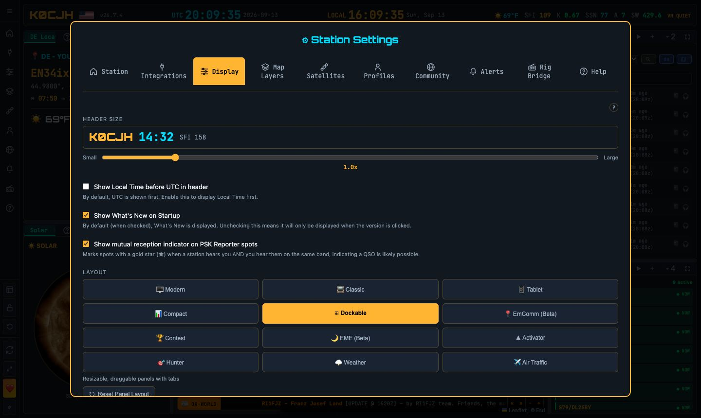

_Settings → Display: layout, theme, fonts, header size, scene rotation_

The interface chrome — panel picker, settings tabs, sidebar, and map control buttons — now uses a stroke-based line-icon set instead of emoji, so icons render identically on every OS and follow your theme colors. Panels added by plugins keep showing their emoji.

**Dark** (default), **Light**, **Legacy** (green CRT terminal), **Retro** (90s Windows), and **Custom** — a full editor for backgrounds, text, borders, map ocean, and every accent color. You can also pick the monospace font used for callsigns and frequencies (JetBrains Mono, Fira Code, IBM Plex Mono — the latter two with slashed zeros). Six more themes join the lineup, and the character themes bring a whole design language, not just a palette: **Matrix** (the movie treatment — live katakana digital rain falling behind translucent glass panels, CRT scanlines, phosphor glow, flickering headers, all-monospace; the rain is skipped in Low Memory Mode and under reduced-motion), **8-Bit** (console graphics — pixel font on headers and buttons, stepped pixel-rounded dialog corners, solid menu-bar headers, buttons that physically press in, pixelated map tiles), **Trek** (LCARS-style bridge console — pure black wells with rounded orange/lavender elbow bars, pill headers and pill buttons, condensed all-caps type), **Steampunk** (brass double-frame panels with corner rivets, engraved serif headers, sepia-aged map tiles), plus two color moods: **Midnight** (deep blue and ice) and **Ember** (tube-amp warmth). All work everywhere the built-in themes do, including the map ocean color and both 2D and 3D projections. Self-hosted installs get the pixel and LCARS fonts after re-running `scripts/vendor-download.sh`; without them the themes fall back to system faces.

<table>
<tr><td width="50%" valign="top">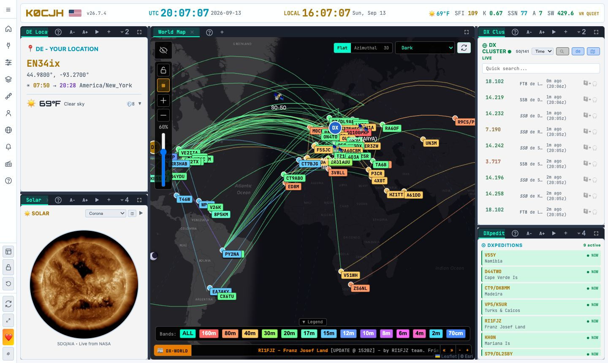 Light</td><td width="50%" valign="top">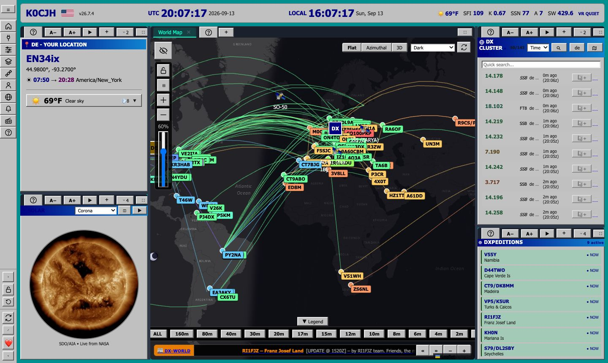 Retro</td></tr>
<tr><td width="50%" valign="top">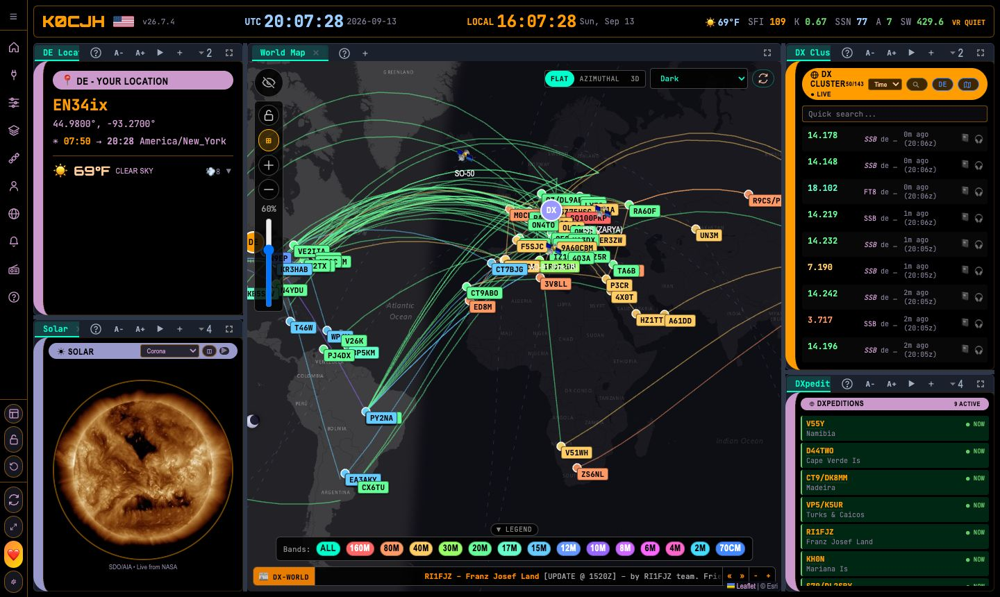 Trek (LCARS)</td><td width="50%" valign="top">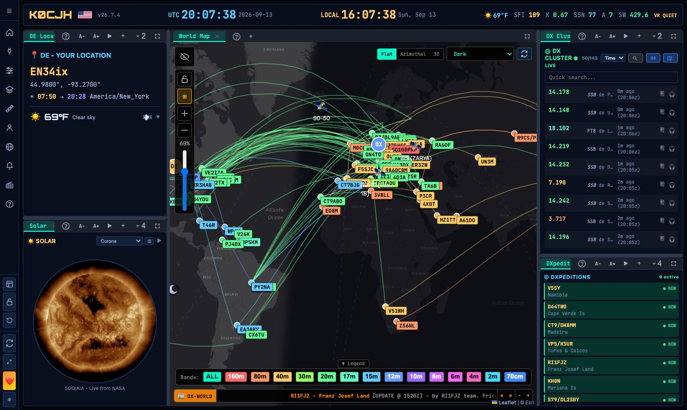 Midnight</td></tr>
</table>

The four **season themes** each bring a palette, a matching map tint, and living weather drawn over the interface: **Winter** (frost-steel blues with drifting snow and frost creeping down panel edges), **Spring** (a light meadow theme with falling blossom petals), **Summer** (sun-washed sand with fireflies wandering after dark colors), and **Fall** (foliage golds and maple reds with tumbling leaves). The animations follow the same rules as the Matrix rain — skipped in Low Memory Mode and under reduced-motion. Each season also hides at least one easter egg that only appears on the right day of the year; we won't spoil the dates, but operators who work Field Day may notice the fireflies acting oddly well-trained.

**Christmas Eve 🎅** — from 24 December 10:00 UTC (midnight in the first time zone) the 3D globe and the flat map show Santa's sleigh and reindeer working westward around the world, one time zone per hour, with a status line naming the city he is over, his next stop, and the presents delivered so far. He is parked at the North Pole before launch and after the run, and gone again on 26 December. To show it to the kids on any other day, open the app with `?santa=1` (or `?santa=2026-12-24T18:00Z` for an exact moment); `?santa=off` switches the simulation off again.

Display extras: header size slider, local-time-first clock swap, mutual-reception star toggle, a **Display Schedule** (sleep/wake times for shack TVs, with an option to keep the HDMI signal alive), **Keep Awake** wake-lock, and **Low Memory Mode** for machines under 8 GB.

### Profiles (Settings → Profiles)

A profile captures _everything_ — callsign, location, theme, layout, dock arrangement, map layers, filters, satellite selection, propagation preferences, units. Save under a name, **Load** to switch (page reloads), **Update** to overwrite, **Export/Import** as JSON to move between devices or operators. Perfect for shared shacks and contest-vs-everyday setups. Profiles can also be selected as **Scene Rotation** scenes (Settings → Display), so a kiosk can cycle through entire saved configurations, not just layouts — renaming a profile keeps it in the rotation.

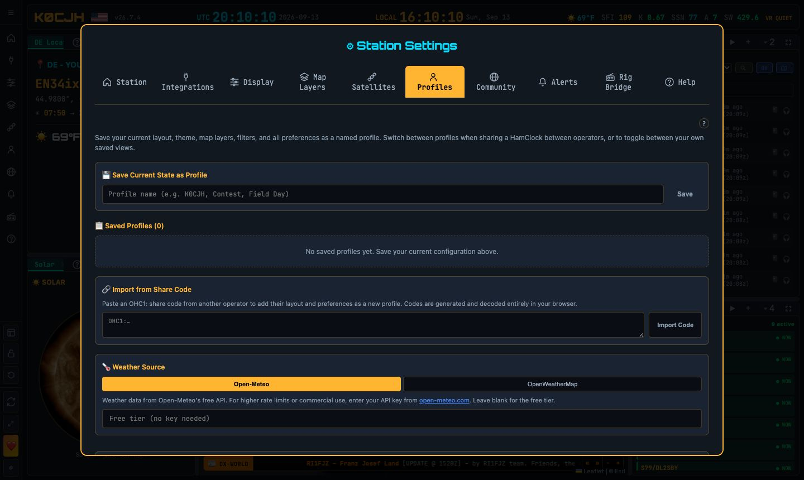

_Settings → Profiles: save, load, export/import, share codes, and full backup_

**Share codes**. Every saved profile also gets a 🔗 **Copy share code** button — the whole profile packed into a single `OHC1:…` string you can paste into an email, a group chat, or a forum post. The receiving side pastes it into **Import from Share Code** on the same tab and gets your layout as a new named profile. Codes are compressed and decoded entirely in the browser; nothing is uploaded anywhere.

**Full Backup**. The answer to "the logbook lives only in this browser": **Export Full Backup** downloads one `ohc-backup-YYYYMMDD-HHMMSS.json` containing every settings key, all saved profiles, _and_ your entire logbook. **Restore from Backup** reads such a file on a new machine (or after a browser wipe): settings are overwritten, QSOs are merged into the existing log with duplicates skipped, and you get a summary of what was restored. Callbook logins (QRZ/HamQTH) and API keys are deliberately **not** included in backup files — they stay private to each browser, so re-enter them after a restore. The tab also shows when this browser last exported a backup.

---

## Languages

The interface ships in **16 languages**: English, Français, Español, Català, Deutsch, Nederlands, Italiano, Português, 日本語, ქართული, 한국어, Melayu, Русский, Slovenščina, ไทย, and 简体中文. Pick yours in Settings → Station. Map tile labels follow your chosen language where the tile provider supports it.

Want to add or improve one? See the [translation guide in CONTRIBUTING.md](../CONTRIBUTING.md#translations) — partial translations are welcome.

---

## Remote control and kiosk

Everything in this chapter is aimed at a display you walk up to rather than
sit at: a shack monitor, a club-room TV, a hamfest booth.

### Remote control API and phone remote

Turn on **Settings → Station → Remote control** (on by default on self-hosted
and Pi installs, off on the hosted site) and the display listens for
commands from the server's `/api/control` API — set DE/DX, switch layout and
theme, toggle map layers, pick a satellite, shift the clock, drive the
stopwatch, point the rotator, grab a screenshot. The full command table with
`curl` examples is in [docs/API.md → Remote control API](API.md#remote-control-api);
the names are short verbs.

Each browser has a **display id** (shown in that section, with a **New id**
button); commands address it with `?target=<id>`. On a local install you can
leave the target off and every display on that server follows. The section
also shows a **QR code**: scan it with a phone on the same network to open
the **phone remote** at `/remote?target=<id>` — big touch buttons for DX by
callsign or grid, layout, theme, projection and basemap, common layers,
tracked satellites, docked panels, time shift (±10 min / 1 h / 1 day and
"Now"), alarm, stopwatch and countdown, and rig tuning through the Rig
Bridge cloud relay when this display uses one.

The QR code and the phone URL also carry this display's **pairing key** — a
random secret the browser generates next to its id and registers with the
server (which keeps only a hash). Whoever holds it can drive this display,
and only this one, so it works on openhamclock.com and on any server that
sets `API_WRITE_KEY` without anyone having to hand out the site-wide key;
the admin key still works everywhere. Treat the link like a password: share
it by scanning, not by posting it. **New id** replaces both id and key, and
the remote page shows **Paired ✓** once the server has accepted its key (or
**not paired** when it was refused — scan the current QR code again). If the
Settings section shows **Id in use**, another browser has paired the same id
on this server; press **New id**. The remote page moves the key out of the
address bar into session storage as soon as it connects. Scripts can use the
same key: see [docs/API.md → Authentication](API.md#authentication-pairing-key-or-admin-key).

A screenshot of the display is available at `/api/control/capture.png`. In
the desktop app it is pixel-perfect; in a browser it is a best-effort
composite of the map canvases (text panels are not rendered).

### Kiosk lock

**Settings → Station → Kiosk lock** sets a 4–8 digit PIN (stored hashed in
this browser only). Press **Lock now**, or tap the padlock in the header,
and the display stops opening Settings, changing layouts (the dockable
layout lock is forced on) and opening the command palette — each asks for
the PIN on a touch keypad instead. The padlock in the header shows the state
and unlocks. Kiosk launch scripts can add `?lock=1` to the URL to start
locked; `?lockpin=NNNN` sets the PIN first (both are stripped from the
address bar). `scripts/setup-pi.sh --kiosk --lock-pin=1234` bakes this into
the Pi kiosk launcher.

### Demo mode

**Settings → Display → Demo mode** makes a random harmless change every
30 seconds — adds or focuses a panel (dockable layout), toggles a map layer
such as the gray line or the grid, picks a DX from recent cluster spots, or
rotates the basemap. A running-man indicator appears in the header. It is
never saved: reloading the page turns it off.

### Grayscale display

**Settings → Display → Grayscale** desaturates either the map only or the
whole display (`filter: grayscale(1)`), for monochrome screens, projectors
or a calmer shack display.

### Rotating titles

**Settings → Station → Callsign box titles** takes up to six titles separated
by `;` (for example `Field Day 2026; W1AW; Welcome!`). The callsign box in
the header shows them in turn, ten seconds each; leave the field empty to
show the callsign. The remote `title` command sets a session-only title (with
optional colours) without touching the saved setting.

## Settings reference

A quick map of where things live (⚙ Settings, via the gear or your callsign):

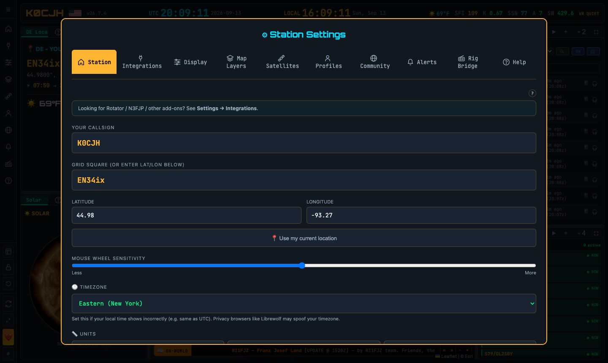

_Settings → Station: callsign, location, units, language, cluster source, propagation defaults_

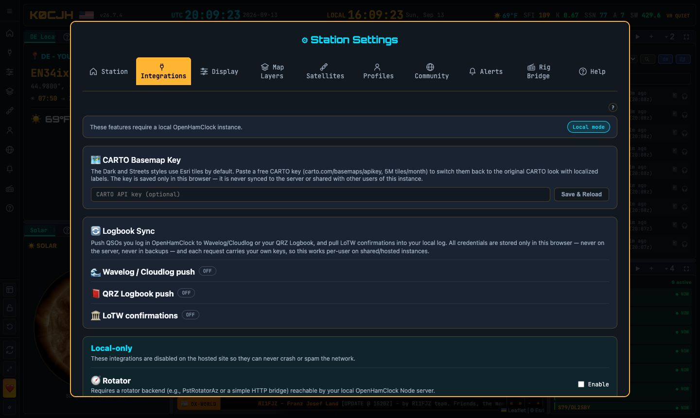

_Settings → Integrations: basemap key, callbooks, rotator, N3FJP_

| Tab                 | What's in it                                                                                                                                                                                                                                                                                                                                       |
| ------------------- | -------------------------------------------------------------------------------------------------------------------------------------------------------------------------------------------------------------------------------------------------------------------------------------------------------------------------------------------------- |
| 📻 **Station**      | Callsign, grid/lat-lon (with "use my location"), timezone, units (distance/temperature/pressure), language, DX cluster source, callbook picker, propagation mode & TX power, performance mode, wake lock & display schedule, Active Users opt-out, legacy rig control, GPS (Rig Bridge: off / set once / follow), bearings (true / magnetic north) |
| 🔌 **Integrations** | CARTO basemap key, QRZ.com and HamQTH callbook credentials, and local-only extras: Rotator, DX Weather popups, N3FJP bridge                                                                                                                                                                                                                        |
| 🎨 **Display**      | Layout, theme (+ custom theme editor), monospace font, header size, clock order, What's New on startup, mutual-reception star, brightness slider & auto brightness (Rig Bridge light sensor)                                                                                                                                                       |
| 🗺️ **Map Layers**   | Every overlay layer with enable + opacity, grouped by category; DE/DX markers, DX Target panel, and DX News ticker toggles; offline map areas                                                                                                                                                                                                      |
| 🛰️ **Satellites**   | Satellite selection, tracks/footprints, station altitude, minimum elevation, track duration; automation & alerts: max TLE age + Refresh TLEs, hams.at API key, Doppler retune step, rotator step / elevation travel / stop / pre-position                                                                                                          |
| 👤 **Profiles**     | Save/load/rename/export/import named profiles; profile share codes and full backup/restore; weather source picker — Open-Meteo (default, keyless) or OpenWeatherMap with your own key; export current state                                                                                                                                        |
| 🌐 **Community**    | GitHub, Facebook group, Reddit; core maintainers and the contributors wall; the privacy statement (no cookies, no tracking, anonymized stats)                                                                                                                                                                                                      |
| 🔔 **Alerts**       | Per-feed audio alerts, tones, master volume, browser notifications, Web Push, lightning guard (radii, all-clear time, alert channels, antenna relay), spoken alerts                                                                                                                                                                                |
| 📻 **Rig Bridge**   | Enable/connect, downloads for each OS, API token, click-to-tune and auto-mode, plugin overview, Cloud Relay, beacon monitor, lightning relay GPIO line                                                                                                                                                                                             |
| ❓ **Help**         | This manual, rendered in-app with a searchable contents sidebar; the ❓ icons throughout the app deep-link here                                                                                                                                                                                                                                    |

Settings save to your browser; **Save Settings** applies them. Most `.env` variables mirror a Settings option — the browser value wins.

---

## Hosted site vs self-hosted

Both run the same code; the differences come down to hardware access and being a good neighbor on a shared server:

| Capability                                                    | openhamclock.com (hosted)                               | Self-hosted                                                                    |
| ------------------------------------------------------------- | ------------------------------------------------------- | ------------------------------------------------------------------------------ |
| All panels, layers, propagation, logbook                      | ✅                                                      | ✅                                                                             |
| DX cluster source                                             | OpenHamClock Cluster (locked)                           | Your choice, including custom telnet and UDP                                   |
| Rig control                                                   | ✅ via Rig Bridge + Cloud Relay                         | ✅ via Rig Bridge directly                                                     |
| WSJT-X decodes                                                | ✅ via Rig Bridge / relay agent                         | ✅ direct UDP                                                                  |
| Rotator, N3FJP bridge, DX weather popups, Global Clouds layer | ❌ (local-only)                                         | ✅                                                                             |
| Callbook credentials (QRZ/HamQTH)                             | Per-user, verified then stored **in your browser only** | Server-wide via Settings or `.env`                                             |
| Settings sync across devices                                  | ❌ (use profile export)                                 | ✅ optional `SETTINGS_SYNC=true`                                               |
| APRS-IS feed                                                  | Shared server connection                                | Your own connection, your own filter                                           |
| HamAlert feed                                                 | Per-user via Rig Bridge + Cloud Relay                   | Rig Bridge, or one shared server session via `HAMALERT_USER` / `HAMALERT_PASS` |
| Message of the day banner                                     | Set by the site admins                                  | Your own: `MOTD` env or `POST /api/admin/motd`                                 |

Local-install detection is automatic (localhost, LAN IPs, `.local`/`.lan` hostnames); a self-hosted server can force it with `SERVERLOCAL=true` — useful behind a reverse proxy with a public domain name.

**Message of the day (self-hosters):** put a one-line notice in front of everyone using your instance — planned downtime, a club net reminder, a new feature. Set `MOTD="Text with https://links.example"` in `.env`, or change it live without a restart with `curl -X POST -H "Authorization: Bearer $API_WRITE_KEY" -H 'Content-Type: application/json' -d '{"text":"Server restart at 0200z"}' http://localhost:3000/api/admin/motd` (an empty `text` clears it; an admin message overrides the env one). Browsers show it as a dismissible bar across the top; bare URLs become links, and once a user dismisses a message it stays hidden in that browser until the text changes. Details in [API.md](API.md#message-of-the-day).

---

_Something missing or wrong? Documentation PRs are welcome — see [CONTRIBUTING.md](../CONTRIBUTING.md#documentation). 73!_
